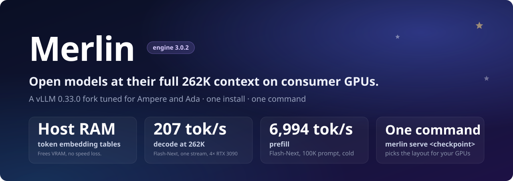
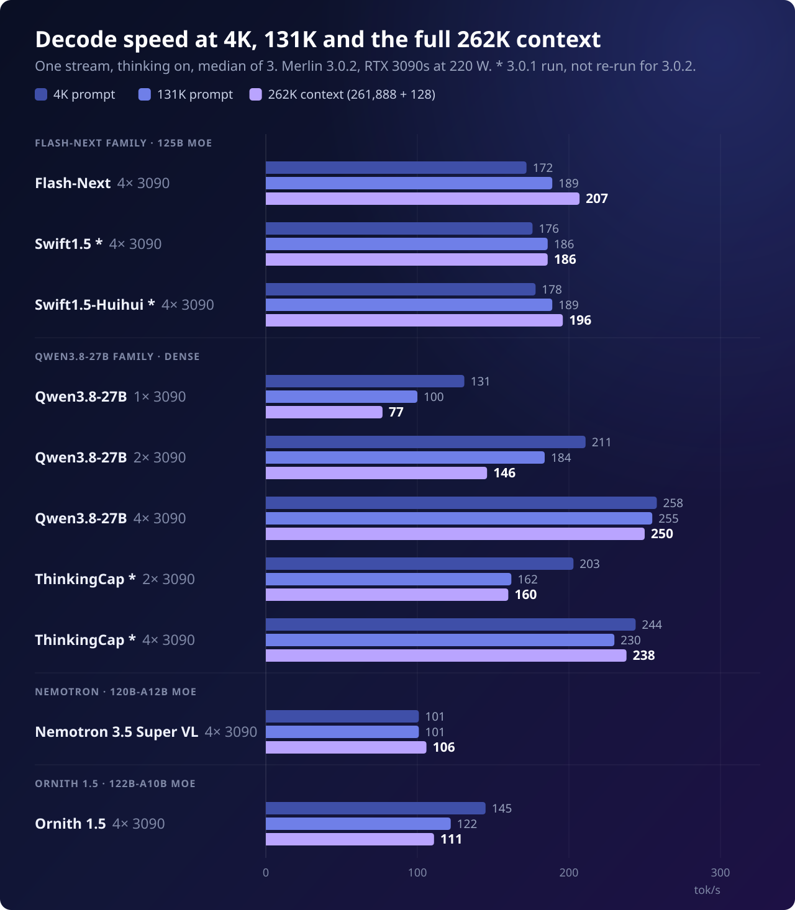

<!-- Modified by the Merlin project; see NOTICE. -->
<div align="center">



[](https://github.com/vllm-project/vllm/tree/v0.33.0)
[](#hardware)
[](#models)
[](LICENSE)
[](https://ko-fi.com/halt95)
[](https://discord.gg/jVDYAwdGzt)

**[Quick start](#quick-start) · [Models](#models) · [Features](#features) · [Performance](#performance) · [Hardware](#hardware) · [How to serve](docs/how-to-serve.md) · [Changelog](docs/CHANGELOG.md)**

</div>

<br>

Merlin is a [vLLM](https://github.com/vllm-project/vllm) fork tuned for NVIDIA Ampere and Ada GPUs. It runs seven open
models at their full 262K context (Nemotron 3.5 Super VL at its 1M context) on four RTX 3090s, behind one OpenAI-compatible API with vision, reasoning and
tool calling. One install, one command with pre-tuned profiles for your detected GPUs.

## Quick start

```bash
git clone https://github.com/halt95/merlin-engine.git && cd merlin-engine && ./setup.sh
```

The setup script checks your GPUs, suggests a model, shows each download and its size before it starts, then
launches the server on `127.0.0.1` (port 8000; 8100 for the 27B and ThinkingCap). Nothing is installed system-wide. Run it again to restart the server.

The [How to serve](docs/how-to-serve.md) guide covers the rest: [Merlin's commands and flags](docs/how-to-serve.md#2-merlin-commands),
talking to the server, serving on your network, picking GPUs and switching models.

<details>
<summary><b>Manual install</b></summary>

```bash
git clone https://github.com/halt95/merlin-engine.git && cd merlin-engine
curl -LO https://github.com/halt95/merlin-engine/releases/download/merlin-v3.0.2.1/vllm-0.33.0+merlin.c56eeed392-cp313-cp313-linux_x86_64.whl
MERLIN_WHEEL="$PWD/vllm-0.33.0+merlin.c56eeed392-cp313-cp313-linux_x86_64.whl" bash release/install-env.sh ./venv

venv/bin/hf download halt95/Qwen3.8-Flash-Next-W4A16-Merlin --local-dir ~/models/flash-next
(cd ~/models/flash-next && sha256sum -c "$OLDPWD/models/flash-next/checkpoint.sha256")
venv/bin/merlin serve ~/models/flash-next
```

The wheel is checked against `release/merlin-wheel.sha256`. Without `MERLIN_WHEEL` the installer builds the engine
from source, which takes about 1.5 hours on 8 cores. The first start compiles kernels; the server is ready when
`merlin: Ready: ...` prints.

</details>

## Models

| Model | Type | GPUs | KV pool, tokens | Decode at 262K | 8 agents, thinking on | 8 agents, thinking off | GSM8K-200, thinking on | GSM8K-200, thinking off |
|---|---|---|---|---|---|---|---|---|
| [Flash-Next](https://huggingface.co/halt95/Qwen3.8-Flash-Next-W4A16-Merlin) | 125B MoE | 4 | 924,993 | 192 tok/s | 640 tok/s | 641 tok/s † | 197 | 198 |
| [Swift1.5](https://huggingface.co/halt95/Swift1.5-Qwen3.8-Flash-Next-W4A16-Merlin) | Flash-Next fine-tune | 4 | 924,993 | 182 tok/s | 688 tok/s | 661 tok/s | 199 | 198 |
| [Swift1.5-Huihui](https://huggingface.co/halt95/Swift1.5-Huihui-Qwen3.8-Flash-Next-W4A16-Merlin) | Swift1.5, abliterated | 4 | 924,993 | 203 tok/s | 719 tok/s | 668 tok/s † | 198 | 197 |
| [Qwen3.8-27B](https://huggingface.co/halt95/Qwen3.8-27B-W4A16-Merlin) † | 27B dense | 1 / 2 / 4 | 271,506 / 826,689 / 2,012,105 | 75 / 160 / 233 tok/s | – / 740 / 970 tok/s | – / 677 / 857 tok/s | 198 (4 GPUs) | 194 / 194 / 195 |
| [ThinkingCap](https://huggingface.co/halt95/ThinkingCap-Qwen3.8-27B-W4A16-Merlin) † | 27B fine-tune | 2 / 4 | 826,689 / 2,012,105 | 163 / 233 tok/s | 731 / 974 tok/s | 663 / 856 tok/s | 196 (4 GPUs) | 195 / 193 |
| [Nemotron 3.5 Super VL](https://huggingface.co/halt95/Nemotron-3.5-Super-VL-120B-A12B-W4A16-Merlin) † | 120B MoE, 1M context | 4 | 1,856,367 | 101 tok/s | 444 tok/s | 417 tok/s | 196 | 194 |
| [Ornith 1.5](https://huggingface.co/halt95/Ornith-1.5-122B-A10B-W4A16-Merlin) † | 122B MoE | 4 | 894,618 | 107 tok/s | 516 tok/s | 484 tok/s | 195 | 191 |

<sub>Merlin 3.0.2.1 · 4 x RTX 3090 at 220 W, P2P on ([aikitoria's driver](https://github.com/aikitoria/open-gpu-kernel-modules)) and [Zagitta's gpu-unlock](https://github.com/Zagitta/gpu-unlock) · 2026-11-10 to 2026-11-12.<br>
Decode: one stream, thinking on, full 262K context · 8 agents: total throughput on 16K conversations · GSM8K-200: correct out of 200.<br>
Build of each cell, ranges and method: the [bench cards](benchmarks/2026-11-12/README.md); † previous build (ThinkingCap's two-card 262K decode excepted), see cards.</sub>

## Features

- **More context in the same VRAM.** Embedding tables live in host RAM, so the cards hold more KV cache.
  Flash-Next keeps three full 262K conversations in memory on four 3090s.
- **FP8 KV cache on Ampere,** with our own kernels for cards that lack native FP8.
- **Faster prefill.** Up to 33 % faster at 262K in Merlin 3.0.1 than in 3.0.0, with the optional gpu-unlock host upgrade;
  3.0.2 against 3.0.1: unchanged within run-to-run spread, except Nemotron 3.5 Super VL +8 %; 3.0.2.1 against 3.0.2:
  unchanged within run-to-run spread.
- **On vLLM 0.33.** torch 2.14, Triton 3.8 and FlashInfer 0.7.2.post1, with the sm_86 FP8 patches carried over.
- **Built for agents.** Follow-up turns resume from cache, even when more conversations are open than the cache can
  hold.
- **KV RAM cache (experimental).** `--kv-ram-cache 24g` keeps conversation prefixes the GPU evicts in host RAM and
  restores them with identical output: on Flash-Next a 262K restore takes 1.2–1.4 s instead of about 45 s to recompute (Merlin 3.0.1, vLLM 0.32).
  Since 3.0.2.1 it keeps its speed once full ([details](docs/CHANGELOG.md#highlights)).
- **Swarm mode (experimental).** `--swarm` raises the session cap on four RTX 3090s, from 8 to 24 on the Flash-Next
  family and from 24 to 32 on the 27B family, with a 48 GB KV RAM cache. Tested on Flash-Next and the 27B with P2P (Merlin 3.0.1, vLLM 0.32).
- **Flash-Next: shared prompts reused, long prompts take turns.** A first turn behind a shared system prompt resumes from
  a cached checkpoint (FGPC), and a long cold prompt holds running sessions back less (prefill runs); both on since 3.0.2.1 ([details](docs/CHANGELOG.md#highlights)).
- **Flash-Next, Swift1.5 and Swift1.5-Huihui on four 20 GB cards (untested ⚫).** One 262K session on RTX 3080 20GB,
  RTX A4500 or RTX 4000 Ada cards, with static cold-expert offload (`MERLIN_COLD_EXPERTS`); emulated for Flash-Next only.
- **PLE table on NVMe (experimental).** `--ple-store disk` reads the Flash-Next family's embedding table from NVMe
  instead of host RAM, freeing about 47.7 GiB for about 2 % slower decode once cached; `ram` stays the default. [Costs and limits](docs/how-to-serve.md#the-ple-table-on-nvme-experimental).
- **DFlash2 for the Flash-Next family.** `--spec dflash2` on four RTX 3090s with P2P decodes 5–18 % faster than MTP
  (Merlin 3.0.1, vLLM 0.32), which stays the default.
- **Vision, reasoning and tool calling** on every model, with images up to 8 MP (Nemotron: its native ~3.4 MP; the 27B
  on one card: 4 MP; not re-measured on Pillow 13). Quoted tool calls stay text (`MERLIN_QWEN3_LITERAL_SPANS`).
- **Low idle power.** Four idle 3090s draw 110 W (Merlin 3.0.0, vLLM 0.32).
- **One command.** `merlin serve <model>` picks the best layout for the GPUs it finds.
- **A Ready line and a bug-report file.** `merlin serve` prints the URL, model, context length and key location once the
  server answers (`MERLIN_READY_BANNER=0` turns it off); `merlin doctor --report [FILE] [--log FILE] [--lines N]` writes one
  redacted file for bug reports; [client settings](docs/clients.md) for OpenAI-compatible and Anthropic-compatible clients such as opencode, Cline/Roo, Aider and Continue.

<details>
<summary><b>What Merlin adds to vLLM</b></summary>

**More context in the same VRAM**

- **Token embedding tables in host RAM.** The token embedding tables of the main model and its MTP drafter are read
  from pinned host memory, on by default for the Flash-Next and Qwen3.8-27B families (about 1.2 GiB per card freed on
  27B at TP=2), with no speed loss.
- **N-gram embedding table in host RAM.** Flash-Next's n-gram embedding table (about 47.7 GiB) lives in system
  memory, one copy shared by every GPU, so the VRAM goes to KV cache: a 924,993-token pool on four RTX 3090s, three
  full 262K sessions resident at once. With `--ple-store disk` (experimental) it is read from NVMe instead.
- **FP8 KV cache on Ampere.** An sm_86 FP8 QSA attention reader for Flash-Next, and an sm_86 FP8 small-query verify
  tile for 27B, so every checkpoint keeps an FP8 KV cache on cards with no native FP8.
- **QSA indexer scratch reserve (opt-in).** `VLLM_MERLIN_QSA_SCRATCH=reserve|workspace` lets the KV sizing see
  Flash-Next's QSA indexer scratch; `off` stays the default, and KV capacity figures for the two modes have not been measured for 3.0.2.
- **Static cold-expert offload.** `MERLIN_COLD_EXPERTS=<profile.json>` keeps each named MoE layer's hottest experts on
  the GPU and reads the rest from pinned host RAM; output is identical. On by default on the 4 × 20 GB Flash-Next rows;
  `MERLIN_COLD_EXPERTS_LAYERS`, `MERLIN_COLD_EXPERTS_HOT_FRAC` and `MERLIN_COLD_EXPERTS=0` ([flags](docs/CHANGELOG.md#new-flags-and-environment-variables)).
- **Leaner boots.** `MERLIN_REPACK_RELEASE` (on) frees the allocator's cache after each weight repack, communicators
  are created before the KV is sized, and `--cpu-offload-params` can name one layer (`layers.3.mlp.experts`).

**Faster decode and prefill**

- **RecoverSSM on every checkpoint.** RecoverSSM recovers the GDN and Mamba-2 state for MTP speculative decoding,
  on by default for Flash-Next, Swift1.5, Swift1.5-Huihui, Qwen3.8-27B, ThinkingCap, Nemotron 3.5 Super VL and
  Ornith 1.5. The Flash-Next family drafts over the full vocabulary with a BF16 draft head.
- **Faster prefill, with the optional gpu-unlock host upgrade.** Cold prefill of a full 262K prompt on four
  RTX 3090s, Merlin 3.0.1 against 3.0.0: +17 % on Flash-Next, +32 % on Qwen3.8-27B and ThinkingCap, +33 % on Nemotron 3.5
  Super VL and Ornith 1.5 (measured on vLLM 0.32). A stock-versus-unlocked A/B ties the gain to the unlocked host on Flash-Next and the 27B; Super VL and Ornith 1.5 had no A/B.
  Merlin 3.0.2 on vLLM 0.33, against 3.0.1: unchanged within run-to-run spread, except Nemotron 3.5 Super VL +8 %.
- **Changes to pipeline-parallel decode with RecoverSSM.** Commit kernels are warmed on every pipeline rank at boot, and the
  deferred commit reuses a persistent snapshot ring instead of allocating snapshot storage at every step; output is unchanged. Optional switches,
  both off by default: `VLLM_RECOVERSSM_PP_SPLIT_RECV=1` and `VLLM_MERLIN_PP_DECODE_BALANCE=1`. Effect on decode:
  not yet measured; the A/B has not been run for 3.0.2.
- **Decode-first step budget (experimental, off by default).** `VLLM_MERLIN_DECODE_FIRST=1` keeps running sessions
  decoding while a long cold prefill runs, instead of stalling until it ends. Temperature-0 output is not proven identical
  with it on, so it stays off. On Flash-Next it needs `PREFILL_RUNS=0`.
- **DFlash2 drafter for the Flash-Next family.** `--spec dflash2` runs incoai's block-diffusion drafter on four RTX 3090s
  with P2P: decode 5–18 % faster than MTP (Merlin 3.0.1, vLLM 0.32), and the server holds three 262K sessions instead of
  six 131K ones. MTP stays the default.
- **All-reduce tuned for PCIe P2P.** Flash-Next on P2P hosts uses a PCIe IPC all-reduce for decode-sized messages
  and NCCL's Simple protocol for prefill.
- **Qwen3.8-27B on two RTX 3090s with P2P** sets six decode defaults (`NCCL_PROTO=Simple`, the PCIe-IPC all-reduce,
  `VLLM_DRAFT_BOUNDED_PLAN`, `VLLM_GDN_DECODE_FASTPATH`, `VLLM_GDN_SHARED_ALIGN_INDEX`, `VLLM_TARGET_SEQ_LENS_ASYNC`; [results](docs/CHANGELOG.md#highlights)).
- **Marlin W8A16** for Flash-Next's INT8 GDN projections.

**Built for agents**

- **Follow-ups resume from cache.** Prefix-cache retention keeps each conversation's prefix on a 64-token grid
  instead of the 4,096-token block, so the next turn starts from cache instead of re-reading the whole conversation
  (Flash-Next v2.5.1: median follow-up time to first token 0.96 s, was 1.56 s).
- **Cache-thrash protection, on by default.** Cost-aware admission and session-coherent yields keep follow-ups
  cached when more sessions are open than the pool holds: under 8 × 131K and 12 × 80K oversubscription, follow-up
  turns reused 74.7 % and 82.1 % of their prompt from cache (Merlin 3.0.0, vLLM 0.32).
- **Shared-prefix checkpoints on every Flash-Next-family and 27B-family launcher.** A first turn behind a shared prompt
  of at least one attention block resumes from the cached junction ([FGPC](docs/CHANGELOG.md#highlights); off:
  `-- --no-enable-mamba-shared-prefix-checkpoint`).
- **Long prompts in slices and runs (Flash-Next family).** 512-token slices (`LPT`, `--long-prefill-token-threshold`),
  and prefill runs between decode-only windows while sessions decode (`PREFILL_RUNS=0` / `VLLM_MERLIN_PREFILL_RUNS`; [costs](docs/CHANGELOG.md#known-limits)).
- **KV RAM cache (experimental).** `--kv-ram-cache SIZE` keeps prefixes the GPU evicts in host RAM and restores them
  instead of recomputing them, with exactly the same output as a GPU cache hit. Flash-Next family with MTP and
  Qwen3.8-27B; off by default. [3.0.2.1 fixes](docs/CHANGELOG.md#highlights).
- **Longer context (experimental).** `--context 512k` serves past 262K with YaRN built from the checkpoint's config,
  and refuses a size above the layout's KV pool. Most combinations are untested ⚫; see the
  [Flash-Next reference](models/flash-next/docs/reference.md#context-size-302).
- **Swarm mode (experimental).** `--swarm` raises the session cap on four RTX 3090s, with or without P2P: 8 to 24 on
  Flash-Next, Swift1.5 and Swift1.5-Huihui, 24 to 32 on Qwen3.8-27B and ThinkingCap, with a 48 GB KV RAM cache. Tested
  on Flash-Next and the 27B with P2P (Merlin 3.0.1, vLLM 0.32); Swift1.5, Swift1.5-Huihui and every model without P2P use the same cap untested
  (⚫, expected to work).
- **A chat template that keeps the cache.** Every Flash-Next-family and Qwen3.8-27B-family recipe serves a fixed Qwen3.8 template that accepts system
  messages after the first turn, so coding agents' per-turn notes no longer break the prefix cache.
  Nemotron 3.5 Super VL keeps earlier turns' thinking in the prompt (`truncate_history_thinking: true` opts out).
- **Vision, reasoning and tool calling on every checkpoint,** with images up to 8 MP (Nemotron its native ~3.4 MP,
  one-card 27B 4 MP) and a per-image pixel cap (`MAX_PIXELS`).
- **Forged control tokens stay text.** Content that spells a control token such as `<|im_end|>` is encoded as text
  (`--sanitize-control-tokens`, on; `--reject-mm-with-string-template`, off; Ornith's FIM tokens via
  `VLLM_MERLIN_EXTRA_CONTROL_TOKENS`). `tool_choice="none"` and quoted or unoffered tool calls stay text (`MERLIN_QWEN3_LITERAL_SPANS`).

**Steady in long runs**

- **Fault detection on any rank**, with faster shutdown. Temperature-0 output repeats for one session on one install;
  under concurrency it varies (see the bench cards).
- **Idle cards drop to P8** with the runtime bounds guards on (Merlin 3.0.0, vLLM 0.32): 110 W idle on four RTX 3090s, against 446 W when the
  guard reader kept them awake.
- **Compile-cache fault guard, on by default.** After a sticky CUDA fault the next start sets the used compile cache aside
  and recompiles once, and the compiled model file is checked against its SHA-256 at load.
  `VLLM_MERLIN_COMPILE_CACHE_GUARD=0` restores the 3.0.1 behaviour.
- **Diagnostics on request.** `MERLIN_KV_TIER_DIAG=1` logs KV-tier decisions and `MERLIN_LOAD_PEAK_LOG=1` boot memory
  peaks; both off by default.

**One install, one command**

- **`./setup.sh`** checks the host, recommends a checkpoint and layout for your GPUs, shows every download with its
  size, installs the prebuilt engine (no compiling, nothing system-wide; about 1.5 minutes on 3.0.0; a 3.0.2 or 3.0.2.1
  fresh install has not been timed) and starts the server.
- **`merlin serve <checkpoint>`** recognises the checkpoint, picks the largest tested layout for the GPUs it finds,
  and starts the server; `merlin doctor` checks the host first. Every layout is a profile of `tools/merlin/launch.py`;
  every knob (`PORT`, `HOST`, `KV_BYTES`, `MAX_PIXELS`, ...) is an environment variable.
- **`merlin serve --instances N`** now stays in the foreground and stops all N servers together.
- **Parser and sampling switches.** `REASONING_PARSER`, `TOOL_CALL_PARSER` and `GENERATION_OVERRIDE` replace a recipe's
  parsers or sampling (`none` turns one off); `USE_CKPT_TEMPLATE=1` serves the checkpoint's own template ([flags](docs/CHANGELOG.md#new-flags-and-environment-variables)).
- **`P2P=ipc` (opt-in, untested):** a third interconnect mode on the Flash-Next rows with the PCIe-IPC all-reduce, for
  hosts where NCCL's P2P bootstrap hangs but CUDA peer access works.
- **Container:** `MERLIN_WHEEL_URL` installs the release wheel into the image instead of compiling, and `MERLIN_PROFILE`
  starts a chosen Flash-Next-family profile (thanks to brandon-nuttall); not requalified on a 3.0.2 or 3.0.2.1 image build.
- **Profiles beyond the reference host:** RTX 3090 without P2P, eight RTX 3090s, RTX 4090 (24 and 48 GB),
  RTX A6000 / A40, A100, A30, CMP 170HX and, since 3.0.2.1, 20 GB cards (RTX 3080 20GB, RTX A4500, RTX 4000 Ada:
  Qwen3.8-27B on two or four, Flash-Next, Swift1.5 and Swift1.5-Huihui on four). `--simulate 4x3080-20g` (or `4xa4500`, `4x4000ada`) plans for them without the
  cards.
- **One prebuilt wheel** for sm_80, sm_86 and sm_89, installed from a hash-locked requirements file.
- **New variants just work.** A Flash-Next-family checkpoint that ships its own FP8 KV scales is served with them,
  with no repository update.

</details>

## Performance



<details>
<summary><b>Prefill and time to first token at 262K</b></summary>

| Model | GPUs | Prefill | Time to first token |
|---|---|---|---|
| Flash-Next | 4 | 6,839 tok/s | 38.3 s |
| Swift1.5 | 4 | 6,793 tok/s | 38.6 s |
| Swift1.5-Huihui | 4 | 6,893 tok/s | 38.0 s |
| Qwen3.8-27B † | 1 / 2 / 4 | 587 / 1,117 / 2,115 tok/s | 446.2 / 234.4 / 123.8 s |
| ThinkingCap † | 2 / 4 | 1,116 / 2,115 tok/s | 234.6 / 123.8 s |
| Nemotron 3.5 Super VL † | 4 | 4,193 tok/s | 62.5 s |
| Ornith 1.5 † | 4 | 2,284 tok/s | 114.7 s |

<sub>One stream, cold cache, 261,888-token prompt. † previous build, see cards.</sub>

</details>

**Bench cards:** [Flash-Next](models/flash-next/benchmarks/2026-11-12/BENCH-CARD.md) · [Swift1.5](models/swift1.5/benchmarks/2026-11-12/BENCH-CARD.md) · [Swift1.5-Huihui](models/swift1.5-huihui/benchmarks/2026-11-12/BENCH-CARD.md) · [Qwen3.8-27B](models/qwen38-27b/benchmarks/2026-11-12/BENCH-CARD.md) · [ThinkingCap](models/thinkingcap/benchmarks/2026-11-12/BENCH-CARD.md) · [Nemotron 3.5 Super VL](models/nemotron-super-vl/benchmarks/2026-11-12/BENCH-CARD.md) · [Ornith 1.5](models/ornith1.5/benchmarks/2026-11-12/BENCH-CARD.md)

## Hardware

| GPUs | Status |
|---|---|
| 2× or 4× RTX 3090 | 🟢 Tested and tuned |
| 4× RTX 3090 without P2P | 🟠 Partly tested (Ornith 1.5, Flash-Next PP4), tuning in progress |
| 4× RTX 4090 | 🟡 Testing on cloud-hosted cards, tuning in progress |
| 2× or 4× CMP 170HX 64 GB | 🟡 Testing on cloud-hosted cards, tuning in progress |
| 8× RTX 3090, RTX 4090 48 GB, A100, A30 | ⚫ Profile included, not yet tested by us |
| 2× or 4× 20 GB (RTX 3080 20GB, RTX A4500, RTX 4000 Ada) | ⚫ Profiles included: Qwen3.8-27B on 2× or 4×; Flash-Next, Swift1.5 and Swift1.5-Huihui on 4× with cold-expert offload, one 262K session. Emulated for the 27B and Flash-Next; Swift not booted at 20 GB |

Any NVIDIA sm_80, sm_86 or sm_89 card can run Merlin. The [How to serve](docs/how-to-serve.md#6-which-gpus-run-what)
guide lists which models fit on which cards, and how many full-length conversations each setup holds.

On RTX 3090s, PCIe P2P and Zagitta's [gpu-unlock](docs/merlin/hardware-matrix.md#optional-host-upgrade-gpu-unlock-geforce-ga102) are optional host upgrades: Merlin runs without
them, and our bench numbers (3.0.1, 3.0.2 and 3.0.2.1) are measured with both. In a stock-versus-unlocked A/B the unlock sped up prefill by
about 16–29 %; decode and output are unchanged.

## Requirements

| | |
|---|---|
| OS | Linux x86-64, glibc 2.38 or newer |
| Driver | NVIDIA R580 or later (CUDA 13) |
| Python | 3.13 with [uv](https://docs.astral.sh/uv/) |
| Compiler | GCC 13 or newer |
| Host RAM | 72 GiB for the Flash-Next family on four cards (tested minimum; more with `--kv-ram-cache` or `--swarm`; `--ple-store disk`, experimental, moves the 47.7 GiB table to NVMe) |
| Disk | About 115 GiB for Flash-Next, 66 GiB for Ornith 1.5 |

`merlin doctor` checks your system before anything starts.

## Credits

**Models:** [Qwen](https://huggingface.co/Qwen) · [UkisAI](https://huggingface.co/ukisai/Swift1.5-Qwen3.8-Flash-Next) (Swift 1.5) ·
[huihui-ai](https://huggingface.co/huihui-ai/Huihui-Qwen3.8-Flash-Next-abliterated) (abliteration) · [BottleCap AI](https://huggingface.co/bottlecapai/ThinkingCap-Qwen3.8-27B) (ThinkingCap) ·
[NVIDIA](https://huggingface.co/nvidia/NVIDIA-Nemotron-3.5-Super-VL-120B-A12B-BF16) (Nemotron) · [ornith-ai](https://huggingface.co/ornith-ai/Ornith-1.5-122B) (Ornith 1.5, a fine-tune of Qwen's [Qwen3.5-122B-A10B](https://huggingface.co/Qwen/Qwen3.5-122B-A10B))

**Quantisation:** [Intel](https://huggingface.co/Intel/Qwen3.8-Flash-Next-W4A16-AutoRound) (AutoRound) ·
[RadixArk](https://huggingface.co/RadixArk/Qwen3.8-Flash-Next-NVFP4) (FP8 PLE table) · [DominikBucko](https://github.com/DominikBucko/qwen38-flash-next-2x3090) (MTP packing) ·
[philbert](https://huggingface.co/philbert440) (AWQ)

**Engine:** [vLLM](https://github.com/vllm-project/vllm), FlashInfer, compressed-tensors · [peakcrosser7](https://github.com/peakcrosser7/vllm/commits/release/qwen38next_offload)
(Flash-Next model support, PLE offload) · RecoverSSM by Jurgen Schmied and Zihua Wu · [Sumandora](https://github.com/Sumandora/remove-refusals-with-transformers) (abliteration method) ·
[froggeric](https://huggingface.co/froggeric/Qwen-Fixed-Chat-Templates) (chat template) · [aikitoria](https://github.com/aikitoria/open-gpu-kernel-modules)
(P2P on consumer Ampere) · [Zagitta](https://github.com/Zagitta/gpu-unlock) (GPU unlock) · [incoai](https://huggingface.co/incoai/Qwen3.8-Flash-Next-DFlash2) (DFlash2 drafter) ·
[club-3090](https://github.com/noonghunna/club-3090/discussions/1735) (sm_80 FP8 KV decoder port) · [Sudzpel](https://github.com/Sudzpel) (GPU unlock proposal and measurements) ·
[brandon-nuttall](https://github.com/brandon-nuttall) (YaRN past 262K report, `SEQS`/`MAXLEN` launcher fix, `use_local_argmax_reduction`, TP2×PP4 community rig) · [R-omk](https://github.com/R-omk) (YaRN past 262K crash report and recipes) · [CoolShades](https://github.com/CoolShades) (idle-power report and first fix behind the v2.5.2 engine fix) ·
[jbeemer1](https://github.com/jbeemer1) (KV RAM cache report) · pondzikk · lucifer1004 · Jon-Nielsen · mgabor3141 ·
[Neiko2002](https://huggingface.co/Neiko2002) · [Yarikdevcom](https://github.com/yarikdevcom) · noonghunna · tfriedel (independent work on the same hardware class)

Upstream fixes are credited in the engine repository.

## Support

Merlin is built and tested on one home machine. If it saves you time, you can support it on
[Ko-fi](https://ko-fi.com/halt95).

## Licence

The engine is Apache-2.0, like vLLM; see [LICENSE](LICENSE) and [NOTICE](NOTICE). Each model has its own licence
on its Hugging Face card.

<sub>Coming from `qwen38-flash-next-3090s`? This repository replaces it. Run
`git remote set-url origin https://github.com/halt95/merlin-engine.git`, then reinstall with `./setup.sh`.</sub>
