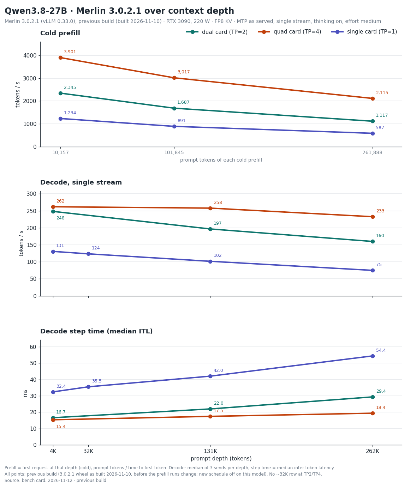

# Qwen3.8-27B — Merlin 3.0.2.1 bench card, 2026-11-12

> **Provenance.** Maintainer measurements on the reference host: 4 x RTX 3090 at 220 W with P2P enabled (aikitoria's open-gpu-kernel-modules P2P driver) and Zagitta's gpu-unlock, PCIe Gen4, no NVLink, driver 610.43.02. Streams are client-timed; drivers, raw streams and boot logs are not published.
> Engine: Merlin 3.0.2.1 on vLLM 0.33.0. Every 3.0.2.1 row on this card ran on the previous build (the 3.0.2.1 wheel `0.33.0+merlin.c56eeed392` as built on 2026-11-10, before the prefill runs change); the published wheel differs from it in three engine files that carry the new prefill schedule, which is off on this model. On 2026-11-11 the same prompt at temperature 0, one session, gave the same 256 token ids on the published wheel as on the previous build.
> Served by `merlin serve` with the shipped defaults, on separate fresh boots: per layout the decode, exact-262K and prefill rows (with thinking-on agents on four and two cards); thinking-on GSM8K-200 on four cards; and per layout the thinking-off agents and GSM8K-200 rows. Measured 2026-11-10 and 2026-11-11 (UTC). Decode comparisons use medians; cold prefill is one request per depth and each 8-agent figure is one overlap run.
>
> Checkpoint: [halt95/Qwen3.8-27B-W4A16-Merlin](https://huggingface.co/halt95/Qwen3.8-27B-W4A16-Merlin). The 3.0.2 column is the [2026-11-04 card](../2026-11-04/Qwen3.8-27B-BENCH-CARD.md).
> Four cards: TP4, `27b-tp4-3090`; thinking-on effort `medium` (the server default); boot 266 s (first start of this configuration: graphs compiled, none loaded from cache); KV pool 2,012,105 tokens.
> Two cards: TP2 on GPUs 0 and 2, `27b-tp2-3090` with P2P on (the six launcher defaults of 3.0.2.1); boot 176 s (first start of this configuration); KV pool 826,689 tokens.
> One card: TP1, `27b-tp1-3090`; boot 151 s (first start of this configuration); KV pool 271,506 tokens.
> MTP K=4, FP8 KV, RecoverSSM on.

## 1. Single-stream decode ladder

Same frozen ladder driver as the 3.0.2 card: T=0, a needle prompt at depth, every send a cold prefill, ≤ 256 tokens
with thinking on and the no-think answer-plus-summary task with thinking off (natural stop, ≤ 1,024 tokens); 3 sends
per cell, each cell the median of the valid sends. tok/s = tokens after the first streamed event / time from the first
to the last event. With MTP, read the median event interval (ITL) together with tokens per event.

### Four cards (TP4)

| prompt tokens | thinking | 3.0.2.1 tok/s | 3.0.2 tok/s | change | ITL ms | tokens/event | TTFT s | valid |
|---|---|---|---|---|---|---|---|---|
| 4,046 | on | 262.0 | 258.1 | +2 % | 15.39 | 4.00 | 1.06 | 3/3 |
| 130,386 | on | 258.0 | 254.6 | +1 % | 17.48 | 4.34 | 46.36 | 3/3 |
| 4,105 | off | 184.5 | 181.4 | +2 % | 15.42 | 2.84 | 1.13 | 3/3 |
| 130,445 | off | 169.8 | 169.0 | 0 % | 17.60 | 2.93 | 46.54 | 3/3 |

### Two cards (TP2, GPUs 0 and 2)

| prompt tokens | thinking | 3.0.2.1 tok/s | 3.0.2 tok/s | change | ITL ms | tokens/event | TTFT s | valid |
|---|---|---|---|---|---|---|---|---|
| 4,046 | on | 248.4 | 210.8 | +18 % | 16.65 | 4.13 | 1.71 | 3/3 |
| 130,386 | on | 196.7 | 183.9 | +7 % | 22.01 | 4.27 | 84.30 | 3/3 |
| 4,105 | off | 165.5 | 139.4 | +19 % | 16.54 | 2.75 | 1.75 | 3/3 |
| 130,445 | off | 133.4 | 125.9 | +6 % | 22.48 | 2.98 | 84.48 | 3/3 |

### One card (TP1)

| prompt tokens | thinking | 3.0.2.1 tok/s | 3.0.2 tok/s | change | ITL ms | tokens/event | TTFT s | valid |
|---|---|---|---|---|---|---|---|---|
| 4,046 | on | 130.7 | 130.9 | 0 % | 32.41 | 4.13 | 3.27 | 3/3 |
| 32,566 | on | 123.5 | - | - | 35.53 | 4.27 | 28.57 | 3/3 |
| 130,386 | on | 101.6 | 99.7 | +2 % | 42.02 | 4.27 | 159.68 | 3/3 |
| 259,557 | on | 80.8 | - | - | 54.17 | 4.27 | 438.42 | 3/3 |
| 4,105 | off | 82.4 | 82.1 | 0 % | 32.37 | 2.66 | 3.33 | 3/3 |
| 32,625 | off | 80.7 | - | - | 34.52 | 2.82 | 28.38 | 3/3 |
| 130,445 | off | 67.5 | 66.7 | +1 % | 42.76 | 2.89 | 159.77 | 3/3 |
| 259,616 | off | 49.7 | - | - | 55.04 | 2.69 | 438.54 | 3/3 |

## 2. Exact 262K

Exactly 261,888 prompt tokens with a 128-token output cap, both thinking modes, one stream, 3 sends with one cache salt
(send 1 cold); each send uses a different prompt text. Decode, ITL and tokens per event are the median of the 3 sends;
TTFT is send 1's. The sends column gives the range of the three sends.

With speculative decoding (MTP), the number of tokens produced per decode step depends on the text being generated, so
over 128 tokens the rate varies from send to send with the text; the range is given beside each median. Measured on
this release on the 27B two-card layout with thinking off: the same prompt text sent 100 times, across four server
starts, gave identical output every time and 100.0–103.5 tok/s, at 2.783 tokens per step on every send; three other
texts gave 106.9–110.3 tok/s; the time per decode step was flat, 27.5–27.9 ms at the client and 28.3–28.6 ms in the
server. On that row the previous development build and this release gave identical output and the same rate (a
paired difference of +0.3 to +0.5 %, inside the difference of about 1 % between two starts of the same build). This
was measured on that one layout and thinking mode only.

### Four cards (TP4)

| prompt tokens | thinking | 3.0.2.1 tok/s (median) | 3.0.2.1 sends, tok/s | 3.0.2 tok/s | change | ITL ms | tokens/event | cold TTFT s |
|---|---|---|---|---|---|---|---|---|
| 261,888 | on | 232.7 | 230.7–252.6 | 249.9 | −7 % | 19.41 | 4.13 | 123.8 |
| 261,888 | off | 163.3 | 163.0–165.9 | 163.0 | 0 % | 19.40 | 2.98 | 123.7 |

### Two cards (TP2, GPUs 0 and 2)

| prompt tokens | thinking | 3.0.2.1 tok/s (median) | 3.0.2.1 sends, tok/s | 3.0.2 tok/s | change | ITL ms | tokens/event | cold TTFT s |
|---|---|---|---|---|---|---|---|---|
| 261,888 | on | 159.9 | 153.1–165.9 | 145.8 | +10 % | 29.36 | 4.27 | 234.4 |
| 261,888 | off | 105.1 | 96.1–118.6 | 107.0 | −2 % | 28.33 | 2.84 | 234.5 |

### One card (TP1)

| prompt tokens | thinking | 3.0.2.1 tok/s (median) | 3.0.2.1 sends, tok/s | 3.0.2 tok/s | change | ITL ms | tokens/event | cold TTFT s |
|---|---|---|---|---|---|---|---|---|
| 261,888 | on | 74.9 | 74.4–77.7 | 76.8 | −2 % | 54.39 | 3.76 | 446.2 |
| 261,888 | off | 54.5 | 51.7–55.5 | 53.8 | +1 % | 53.58 | 2.84 | 445.3 |

In this run send 2 was served cold as well. Four cards, thinking on: send 3 reused 142,320 tokens; thinking off: send 3 reused 142,320 tokens. Two cards, thinking on: send 3 reused 142,064 tokens; thinking off: send 3 reused 142,064 tokens. One card, thinking on: send 3 reused 141,120 tokens; thinking off: send 3 reused 141,120 tokens.

Spread over 6 sends on four cards (the three above plus three more on the same boot, each set with its own cold salt): thinking on 238.1 tok/s (230.7–252.6), thinking off 164.6 tok/s (163.0–171.5).

Four cards: thinking on at 262K is −7 % against 3.0.2 (sends 230.7–252.6 here, 231.7–250.5 on 3.0.2). Median event interval 19.41 ms against 19.49 ms; tokens per event 4.13 against 4.41. The step time is within 1 %, so the difference follows the tokens produced per step, which depend on the text sent.

Two cards: thinking on at 262K is +10 % against 3.0.2 (sends 153.1–165.9 here, 145.7–156.8 on 3.0.2). Median event interval 29.36 ms against 29.44 ms; tokens per event 4.27 against 4.00. The step time is within 1 %, so the difference follows the tokens produced per step, which depend on the text sent.

## 3. Cold prefill

### Four cards (TP4)

| prompt tokens | 3.0.2.1 prefill | 3.0.2 prefill | change | TTFT s |
|---|---|---|---|---|
| 10,157 | 3,901 tok/s | 3,904 tok/s | 0 % | 2.60 |
| 101,845 | 3,017 tok/s | 3,015 tok/s | 0 % | 33.75 |
| 261,888 | 2,115 tok/s | 2,111 tok/s | 0 % | 123.8 |

### Two cards (TP2, GPUs 0 and 2)

| prompt tokens | 3.0.2.1 prefill | 3.0.2 prefill | change | TTFT s |
|---|---|---|---|---|
| 10,157 | 2,345 tok/s | 2,331 tok/s | +1 % | 4.33 |
| 101,845 | 1,687 tok/s | 1,677 tok/s | +1 % | 60.38 |
| 261,888 | 1,117 tok/s | 1,112 tok/s | 0 % | 234.4 |

### One card (TP1)

| prompt tokens | 3.0.2.1 prefill | 3.0.2 prefill | change | TTFT s |
|---|---|---|---|---|
| 10,157 | 1,234 tok/s | 1,219 tok/s | +1 % | 8.23 |
| 101,845 | 891 tok/s | 884 tok/s | +1 % | 114.33 |
| 261,888 | 587 tok/s | 586 tok/s | 0 % | 446.2 |

One cold send per depth (8 tokens out at 10K and 100K). The 262K row is the cold thinking-on send of table 2:
prompt tokens / time to first token.

## 4. Agents at once

Eight 16K conversations, then eight simultaneous 512-token follow-ups, temperature 0. Thinking on is reasoning effort
medium (the server default), each request setting medium. A 512-token follow-up may end inside the reasoning, and
reasoning tokens count, so these totals measure decoded tokens, not finished answers. Total tok/s = tokens decoded
while all eight stream / that overlap window. Each row is one run of 8; a window under 5 s is short, so read that
total loosely, as on the 3.0.2 card.

| layout | thinking | 3.0.2.1 total tok/s | 3.0.2 tok/s | change | overlap window s |
|---|---|---|---|---|---|
| Four cards | on | 970 | 940 | +3 % | 2.83 (short) |
| Four cards | off | 857 | 854 (the 3.0.2 thinking-off figure is the 3.0.1 run the 3.0.2 card carried over) | 0 % | 4.50 (short) |
| Two cards | on | 740 | 682 | +9 % | 3.73 (short) |
| Two cards | off | 677 | 615 (the 3.0.2 thinking-off figure is the 3.0.1 run the 3.0.2 card carried over) | +10 % | 5.55 |

One card's pool (271,506 tokens) holds one 262K conversation or two 131K ones, and its layout admits two sequences at most, so it has no 8-agent row.

## 5. GSM8K-200

The 3.0.1 card's set and method (200 problems, 5-shot, temperature 0). Thinking on at effort medium, on four cards: **198/200**. Thinking off: **195/200** on four cards, **194/200** on two cards and **194/200** on one card; none cut at the token limit with thinking on (with thinking off, the 512-token limit cut 4, 4 and 5 answers). GSM8K with thinking on runs once per checkpoint, on the four-card boot, so the two- and one-card layouts have no thinking-on row. The 3.0.2 card carried 198 (thinking on, 3.0.1 run) and 197 / 194 / 195 (thinking off on 4 / 2 / 1 cards, 3.0.0 run).

## 6. Coverage of this card

| figure | status on 3.0.2.1 |
|---|---|
| Decode ladder, exact 262K, cold prefill, 4, 2 and 1 cards | Measured 2026-11-10, previous build (not re-measured on the published wheel) |
| 8 agents, thinking on, 4 and 2 cards | Measured 2026-11-10, previous build (not re-measured on the published wheel) |
| 8 agents, thinking off, 4 and 2 cards | Measured 2026-11-11, previous build (not re-measured on the published wheel) |
| GSM8K-200, thinking on (4 cards) and thinking off (4, 2, 1 cards) | Measured 2026-11-11, previous build (not re-measured on the published wheel) |
| Sessions held at once | Not re-run; [3.0.0 card](../2026-10-20/Qwen3.8-27B-BENCH-CARD.md) section 4, 2026-10-20 |
| 8 MP images, 4 and 2 cards | Not re-run; [3.0.0 card](../2026-10-20/Qwen3.8-27B-BENCH-CARD.md) section 5, 2026-10-20. Measured on 3.0.2.1, previous build (not re-measured on the published wheel): the memory floor during the 8 MP rows with the new capture sizes, 796 MiB on every card of four (total minus used), sampled every 100 ms on a fresh boot with no decode before the images (the 27B checkpoint and ThinkingCap, one run each); with decode run first, the readings at one-second sampling were 798 and 796 MiB; 764 MiB on two cards (total minus used) |
| Images, 1 card | 4 MP, not 8 MP (8 MP does not fit one card); not re-run; [3.0.0 card](../2026-10-20/Qwen3.8-27B-BENCH-CARD.md) section 5, 2026-10-21 |
| Needle panel | Not re-run; [3.0.0 card](../2026-10-20/Qwen3.8-27B-BENCH-CARD.md) section 6, pre-release build, 2026-10-17 |

Other CPU load on the host: none during any row.
