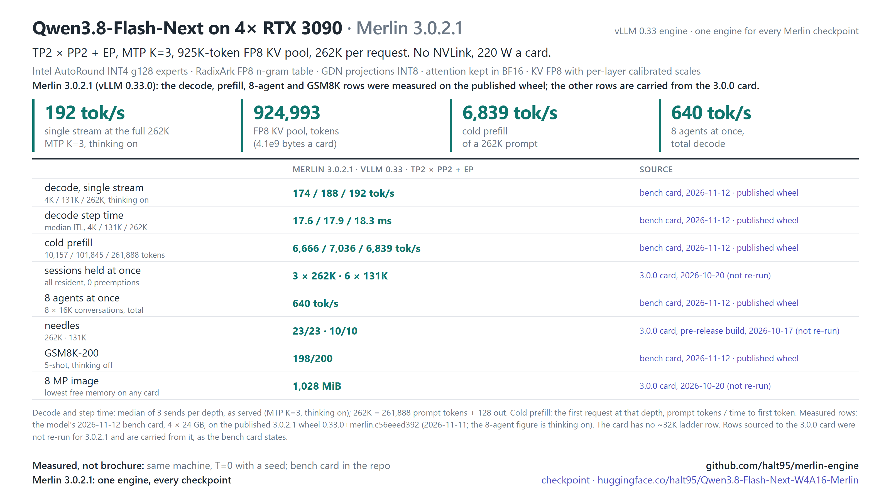

# Qwen3.8-Flash-Next on 4× RTX 3090

The launcher serves Froggeric's fixed Qwen3.8 template,
[`froggeric-qwen-v22.5.jinja`](../qwen38-27b/templates/froggeric-qwen-v22.5.jinja), the same template as the
27B recipes. Unlike the checkpoint's own `chat_template.jinja` (vendored in
[`models/flash-next/templates/`](../flash-next/templates/chat_template.jinja)), it accepts system messages after
the first turn, so coding agents' per-turn notes stay in place on `/v1/messages` and the prefix cache keeps
hitting. `CHAT_TEMPLATE=<path>` serves another template; `CHAT_TEMPLATE=` (empty) serves the checkpoint's own.

**Serve Qwen3.8-Flash-Next at its full 262K context on four RTX 3090s, with vision, tool calls and cached agent
follow-ups, behind one OpenAI-compatible endpoint.**

[](docs/reference.md#hardware)
[](docs/reference.md#the-kv-budget)
[](docs/reference.md#the-kv-budget)
[](docs/reference.md#stack)
[](docs/reference.md#stack)
[](https://huggingface.co/halt95/Qwen3.8-Flash-Next-W4A16-Merlin)

This directory is the Flash-Next recipe of the Merlin engine, **built on vLLM 0.33.0**: the launcher, KV-scale
sidecar, calibration tooling, Proxmox LXC recipe and docs for
[halt95/Qwen3.8-Flash-Next-W4A16-Merlin](https://huggingface.co/halt95/Qwen3.8-Flash-Next-W4A16-Merlin).
The engine source is at the repository root; checkpoints stay on Hugging Face. Recipe version:
[3.0.0](VERSION).



## Why use it

Maintainer measurements on 4× RTX 3090, vLLM 0.32, 2026-10-15.
The concurrency and cache-hit runs used a pre-release vLLM 0.32 build; later release-candidate and merged-source identity checks matched its
T=0 tokens and logprobs without rerunning throughput:

| Measurement | Result |
|---|---|
| Concurrent decode, six concurrent 126,976-token sessions | 574.5 tok/s aggregate; 10.78 ms/tok per agent; cold prefill 5,423 tok/s; 0 preemption |
| Cache hit, MTP off, 32K and 131K repeats | minimum hit ratio 0.998; 32K TTFT 5.78 → 0.315 s (cold → cached) |
| KV pool | 924,993 tokens |
| 8 MP image cap | stage-0 minimum free memory 902 MiB |

See the [0.32 measurement summary](benchmarks/2026-10-15/BENCH-CARD.md) for the evidence boundary.

The cache-hit measurement has MTP off; it does not establish that result for the launcher's default MTP K=3.
The concurrent decode workload is six **127K** sessions; six-131K residency was measured separately on 2026-10-20 (below).

## Merlin 3.0.2.1 bench card (2026-11-12)

Maintainer measurements on 4× RTX 3090 (220 W, PCIe Gen4) with P2P (the aikitoria patched driver) and the Zagitta [gpu-unlock](https://github.com/Zagitta/gpu-unlock) kernel module, on vLLM 0.33.0, fresh `merlin serve` boots. The 4 × 24 GB rows were measured on the published wheel on 2026-11-11, except the thinking-off 8-agent row (its run on the published wheel ended early and was not used); that row (2026-11-11) and the 4 × 20 GB rows (2026-11-10) come from the previous build of that wheel (built on 2026-11-10, before the prefill runs change); method and every cell in the [bench card](benchmarks/2026-11-12/BENCH-CARD.md). Decode is one stream with thinking on at reasoning effort medium, the server default (tok/s after the first streamed token); prefill is one cold request. With thinking on, a 512-token agent follow-up may end inside the reasoning, and reasoning tokens count. Sessions held at once and the 24 GB 8 MP image panels were not re-run; they stay on the earlier cards below.

| Measurement | Flash-Next |
|---|---|
| Decode, 4K / 131K / 262K prompt | 174 / 188 / 192 tok/s |
| Cold prefill, 10K / 100K / 262K prompt | 6,666 / 7,036 / 6,839 tok/s |
| Agents at once (8 × 16K conversations), total, thinking on / off | 640 tok/s / 641 tok/s (thinking on: one run; six repeated runs gave 661–697 tok/s) |
| GSM8K-200 (5-shot), correct of 200, thinking on at medium / thinking off | 197 / 198 |
| GSM8K, full test set (1,319, 5-shot), thinking off, 512 tokens | 1,276 (96.7 %); the previous build of the wheel scored 1,282 (97.2 %), a run-to-run difference (replies vary under concurrency); 3.0.2: 1,281 (97.1 %) |
| 32K needle prompts (9) | 5 of 9 answered, all correct; every miss a refusal (the needle is phrased as a secret passphrase), not a wrong recall. |
| 4 × 20 GB, emulated (4 GiB held back per card) | decode 147 / 158 / 165 tok/s, prefill 4,434 / 4,656 / 4,555 tok/s; one 262K session; 8 agents n/a (pool holds 7 of 8); not measured on real 20 GB cards |
| Sessions held at once | Not re-measured on 3.0.2.1. 3.0.0 run: 3 × 262K and 6 × 131K, every session resident (re-sent prompts ≥ 99.91 % cached), 0 preemptions. |
| 8 MP image, one and two requests at once | Not re-measured on 3.0.2.1. 3.0.0 run: correct; lowest free memory on any card 1,028 MiB (one request) and 1,026 MiB (two at once). |
| KV pool | 924,993 tokens |
| Against 3.0.2 | Within run-to-run spread: decode +1 % / 0 % at 4K / 131K, 262K prefill +1 %. 8 agents −2 % in one run of 8, smaller than the spread of repeated runs, so not a loss. At 262K each decode step is within 2 % of 3.0.2; the 128-token figure varies with the text sent (sends 191.4–200.3 tok/s here), and the published 3.0.2 figure came from different send texts (a repeat run of Flash-Next on 3.0.2 measured 193 tok/s, sends 184–207). |

## Merlin 3.0.2 bench card (2026-11-04)

Maintainer measurements on 4× RTX 3090 (220 W, PCIe Gen4) with P2P (the aikitoria patched driver) and the Zagitta [gpu-unlock](https://github.com/Zagitta/gpu-unlock) kernel module, on vLLM 0.33.0, one fresh `merlin serve` boot per configuration, 2026-11-04; method and every cell in the [bench card](benchmarks/2026-11-04/BENCH-CARD.md). Decode is one stream with thinking on at reasoning effort medium, the server default (tok/s after the first streamed token); prefill is one cold request. With thinking on, a 512-token agent follow-up may end inside the reasoning, and reasoning tokens count. Rows marked (3.0.1 run) were not re-run for 3.0.2 and are on the 3.0.1 card below.

| Measurement | Flash-Next |
|---|---|
| Decode, 4K / 131K / 262K prompt | 172 / 189 / 207 tok/s |
| Cold prefill, 10K / 100K / 262K prompt | 6,585 / 6,994 / 6,782 tok/s |
| Agents at once (8 × 16K conversations), total, thinking on / off | 654 tok/s / 664 tok/s (the off figure is a 3.0.1 run) |
| GSM8K-200 (5-shot), correct of 200, thinking on at medium / thinking off | 197 / 199 (3.0.1 run, the 3.0.1 card's protocol) |
| GSM8K, full test set (1,319, 5-shot), thinking off, 512 tokens | 1,281 (97.1 %); 3.0.1 in the same session: 1,276 and 1,275 (96.7 %) |
| 32K needle prompts (9) | 4 of 9 answered, all correct; 3.0.1 in the same session 6 of 9 twice. Every miss on both versions is a refusal (the needle is phrased as a secret passphrase), not a wrong recall. |
| Sessions held at once | Not re-measured on 3.0.2. 3.0.0 run: 3 × 262K and 6 × 131K, every session resident (re-sent prompts ≥ 99.91 % cached), 0 preemptions. |
| 8 MP image, one and two requests at once | Not re-measured on 3.0.2 (Pillow 13). 3.0.0 run, Pillow 12: correct; lowest free memory on any card 1,028 MiB (one request) and 1,026 MiB (two at once). |
| KV pool | 924,993 tokens |
| Against 3.0.1 | Within run-to-run spread: decode -3 % / +3 % / +5 % at 4K / 131K / 262K, 262K prefill 0 %, 8 agents -3 %. Step time 1.2-1.9 % shorter in every row; cold prefill level in a same-session A/B (+0.5 % at 10K, -0.2 % at 100K). |

## Merlin 3.0.1 bench card (2026-11-02)

Maintainer measurements on 4× RTX 3090 (220 W, PCIe Gen4) with P2P (the aikitoria patched driver) and the Zagitta [gpu-unlock](https://github.com/Zagitta/gpu-unlock) kernel module, one fresh `merlin serve` boot per configuration, 2026-11-01 to 2026-11-02; method and every cell in the [bench card](benchmarks/2026-11-02/BENCH-CARD.md). Decode is one stream with thinking on at reasoning effort medium, the server default (tok/s after the first streamed token); prefill is one cold request. With thinking on, a 512-token agent follow-up may end inside the reasoning, and reasoning tokens count. Thinking-off GSM8K is from the 3.0.0 run. Rows marked (3.0.0 run) were not re-run for 3.0.1; they and the rest of the 3.0.0 figures are on the [3.0.0 bench card](benchmarks/2026-10-20/BENCH-CARD.md).

| Measurement | Flash-Next |
|---|---|
| Decode, 4K / 131K / 262K prompt | 178 / 183 / 197 tok/s |
| Cold prefill, 10K / 100K / 262K prompt | 6,628 / 7,064 / 6,803 tok/s |
| Agents at once (8 × 16K conversations), total, thinking on / off | 677 / 664 tok/s |
| GSM8K-200 (5-shot), correct of 200, thinking on at medium / thinking off | 197 / 199 |
| Sessions held at once (3.0.0 run) | 3 × 262K and 6 × 131K, every session resident (re-sent prompts ≥ 99.91 % cached), 0 preemptions |
| 8 MP image, one and two requests at once (3.0.0 run) | correct; lowest free memory on any card 1,028 MiB (one request) and 1,026 MiB (two at once) |
| KV pool | 924,993 tokens |

## What recipe 3.0.0 ships

- **Engine:** built on vLLM 0.33.0, with the engine source and model recipes in this checkout.
- **Vision:** 8 MP per image (`IMG_CAP_PX=8388608`) at the shipped KV pin
  (`--kv-cache-memory-bytes 4100000000`), with 902 MiB measured stage-0 headroom.
  The cap is a served default, not an enforced limit: a request that raises it
  (`mm_processor_kwargs`) goes past that headroom and can run the engine out of memory.
  The 1x M-RoPE cache is automatic on this engine. Up to 42 images are allowed by the launcher;
  the cap measurement does not establish every combination of image count and concurrent load.
- **FGPC on (since 3.0.2.1):** Flash-Next passes `--enable-mamba-shared-prefix-checkpoint`, so a first turn behind a
  shared prompt of at least one 4,096-token attention block resumes from the shared-prefix junction. Prefix caching is on
  as before. `merlin serve flash-next -- --no-enable-mamba-shared-prefix-checkpoint` turns FGPC off.
- **Launch shape:** TP2 × PP2 with expert parallel, native context limit 262,144 tokens,
  MTP K=3 by default, FP8 KV, and a measured 924,993-token pool.

## What you need

The measured hardware is four headless RTX 3090s with working PCIe peer-to-peer. Other hardware and no-P2P
performance have not been re-measured here on 0.32 or 0.33. Other cards that `tools/merlin/preflight.py` maps to a
profile are **untested / community-validated**: RTX A5000, 3090 Ti and A10 (24 GB class, 3090 rows), A10G and L4 at
22.5 GiB (AWS g5/g6, GCP g2: pin lowered to the reported VRAM, a quad holds one 262K session), RTX A6000 / A40 (48 GB)
and the sm_80/sm_89 rows, except the 4 x RTX 4090 24 GB row and the 2- and 4-card CMP 170HX 64 GB rows: those are
🟡 **testing** (full-model runs passed on cloud-hosted cards; kernel parity qualification is still to run). 12 GB cards (RTX 3080 Ti, 3080 12 GB) are refused. Four 20 GB cards have one ⚫ **untested** layout, TP2xPP2+EP with one 262K session and the static cold-expert offload on by default: `fn-quad-20g-sm86` (RTX 3080 20GB, RTX A4500) and `fn-quad-20g-sm89` (RTX 4000 Ada); other counts of 20 GB cards are refused. See the [hardware matrix](../../docs/merlin/hardware-matrix.md). Use the current repository-wide
[install status](../../release/README.md) for the toolchain and build route.

The imported provisioning guidance allocated 96 GB host RAM and at least 1 GB `/dev/shm`.
These allocations are retained as **v3.0.0 (0.30) figure** guidance; host-memory floor and boot peak
have not been re-qualified by this docs change. The checkpoint is approximately 115 GiB;
allow additional disk space for the environment, build products and caches. Total disk usage is unmeasured.
The checkpoint includes a host-resident n-gram embedding table, so host RAM matters as well as VRAM.

## Quick start

**The shared 0.33 installer is integrated.** The dependency lock is complete: 223 exact pins with artifact SHA-256 hashes, resolved with uv; a dry-run `--require-hashes` install resolves.
Follow [release/README.md](../../release/README.md); the engine is built from this checkout. The old v3.0.0 bundle and compiled-ops commands are historical and are not the current install route.

After a verified 0.33 build and environment are available, run from the repository root:

```bash
venv/bin/hf download halt95/Qwen3.8-Flash-Next-W4A16-Merlin --local-dir ~/models/Flash-Next-Merlin
TREE="$PWD" VENV="$PWD/venv" CACHE_ROOT="$PWD/.vllm-cache" \
  models/flash-next/serve.sh ~/models/Flash-Next-Merlin
```

The launcher requires the verified build-product marker from the installer. Wait for
`Application startup complete` and check `GPU KV cache size: 924,993 tokens`.
No 0.33 boot-time estimate is claimed; the first start compiles kernels again after an upgrade from 3.0.1. The endpoint defaults to `127.0.0.1:8000`; set `VLLM_API_KEY`
if exposing it with `HOST=0.0.0.0`.
See [health checks](docs/reference.md#check-its-working) and [troubleshooting](docs/reference.md#troubleshooting).

### Merlin 3.0.2 opt-ins

MTP and the GPU KV pool remain the defaults. `merlin serve flash-next <checkpoint-dir> --spec dflash2`
selects DFlash2 on the three qualified 4 x 3090 P2P rows in the Flash-Next family. It measured +5–18 %
decode versus MTP, with a smaller 815,203-token KV pool (pin 3,630,000,000 B, FP32 GDN state, align-mode
prefix caching): 3 x 262K sessions (5 x 131K) by the engine's fit, not 6 x 131K.
Run `./setup.sh --model flash-next --spec dflash2` to download and verify the drafter first.

`merlin serve flash-next <checkpoint-dir> --kv-ram-cache 64g` opts into a host-RAM cache of evicted
prefix KV blocks. A drain-ahead write-back stores complete restore units before GPU blocks are reclaimed.
Host eviction takes idle rows first, then copies that duplicate blocks running requests hold on the GPU, then the
least recently used content, and last copies whose GPU twins are about to be reclaimed; an evicted unit gives
up only the rows no other session shares, so a common system prompt stays cached. There is no retention interval.
The tier needs at least one 262K restore unit per rank: the smallest size on 4 x 3090 is `8g` (2 GiB per rank), and
[SETUP](../../docs/SETUP.md) lists the other layouts. Capacity is counted in whole restore units: by the layout math, 16g on 4 x 3090
is about 260 host rows per rank, room for 3 whole 262K units (68 rows each, about 4.2 GiB per session over the four ranks).
That is a row count, not a measured restore count: how many long sessions restore reliably at a given size is not
yet measured. A 262K restore took 1.2–1.4 s on 4 x RTX 3090, against about 45 s to recompute. Budget the cache in addition to the server's
host RAM and allow locked memory. **The cache is experimental on Flash-Next:** under heavy concurrent
prefill a session may recompute rather than restore (output remains identical). It runs with MTP only;
`--spec dflash2` with `--kv-ram-cache` is refused. The cache does not change the session cap. `merlin serve --swarm`
(also experimental) serves up to 24 sessions instead of 8 on the 4 x 3090 profiles, with the cache at the tested 48g or
more (12 GiB per rank; set to 48g when `--kv-ram-cache` is not given, a smaller one is refused); the boot log says which
cap applies (default or `--swarm`; an exported `SEQS` above the default is warned about).
See [3.0.1 options](docs/reference.md#merlin-301-options) for the supported rows, drafter path and per-rank sizing.

`merlin serve flash-next <checkpoint-dir> --ple-store disk` (**experimental**) reads the embedding table's rows from the
checkpoint's own files on NVMe instead of holding the table in host RAM, which frees 47.7–47.8 GiB with FP8 (38.8–38.9 GiB
with `--ple int6`) for about 2 % slower decode once the table is cached; the figures were measured on the 0.32 tree
(on 3.0.2 the FP8 table was re-measured on vLLM 0.33: output identical, decode and warm first token within
run-to-run noise; the INT6 figures are from the 0.32 tree). See [How to serve](../../docs/how-to-serve.md#the-ple-table-on-nvme-experimental) for costs and limits.
`--context 512k` serves past 262K with YaRN built from the checkpoint's config (**experimental**; see
[Context size](docs/reference.md#context-size-302)). On the TP2 × PP2 layout, two optional engine switches are off by default:
`VLLM_RECOVERSSM_PP_SPLIT_RECV=1` and `VLLM_MERLIN_PP_DECODE_BALANCE=1` (see [3.0.2 options](docs/reference.md#merlin-302-options)).

`./setup.sh --model flash-next --ple int6` (or `merlin pull flash-next --ple int6`) selects the INT6 g32 PLE table:
38.74 GiB of host RAM instead of FP8's 47.68 GiB (measured on the reference host: no quality loss against FP8; MTP draft
acceptance +0.095 on Flash-Next and −0.03 on Swift 1.5, within the 0.10 bar; decode and prefill speed not measured separately).
There is no second checkpoint. One INT6 pack, downloaded once into `flash-next-ple-int6` beside the checkpoint, serves
Flash-Next and Swift 1.5 (they share byte-identical FP8 PLE shards). Swift 1.5 Huihui carries the same shards but is
excluded for now: its MTP acceptance with the INT6 table fell past the threshold, so it stays on FP8. Setup verifies your FP8
checkpoint and the pack, then builds `<checkpoint>-int6`: links to both plus a generated `config.json` and index. Your
FP8 files are never changed, and FP8 stays the default. Serve it with
`merlin serve flash-next <checkpoint>-int6 --ple int6`. The estimated resident floor is 60.06 GiB at four workers (69 GiB
with FP8); no capped-host boot has measured it yet. Details: [docs/SETUP.md](../../docs/SETUP.md).

### Container

The shared [container recipe](../../container/README.md) builds this checkout through the 0.33
installer. The image still needs hardware qualification.

### Proxmox LXC

The imported [LXC recipe](docs/reference.md#proxmox-lxc) describes the reference host's deployment.
Its provisioning/build integration has not been re-qualified on the 0.33 tree.

## Talk to it

Any OpenAI-compatible client works. With curl:

```bash
curl http://127.0.0.1:8000/v1/chat/completions -H 'Content-Type: application/json' \
  -d '{"model": "flash-next", "messages": [{"role": "user", "content": "Hello!"}]}'
```

Or from Python with the `openai` package (set `OPENAI_API_KEY` to your `VLLM_API_KEY`, or to any value if you set none):

```python
from openai import OpenAI
client = OpenAI(base_url="http://127.0.0.1:8000/v1")
reply = client.chat.completions.create(model="flash-next", messages=[{"role": "user", "content": "Hello!"}])
print(reply.choices[0].message.content)
```

- Thinking is on by default. A short `max_tokens` can end inside the reasoning with empty `content`; send
  `"chat_template_kwargs": {"enable_thinking": false}` to turn it off for a request.
- Tools use the standard `tools` field; images go in `image_url` content parts, up to 42 per request.
- Multi-turn and the prefix cache: send each assistant turn back as it was returned, with its `reasoning` (or
  `reasoning_content`) and `tool_calls`. Keep `reasoning_effort`, `enable_thinking` and the `tools` list the same for
  the whole conversation and leave `preserve_thinking` on: all of them are rendered at the top of the prompt or into
  every past turn, so a change re-reads the history instead of reusing the cache. For exact reuse, send
  `/v1/completions` with token-ID prompts: the previous prompt's ids plus the returned ids (`"return_token_ids": true`).
- If a reply comes back empty with `finish_reason: "stop"` and zero tokens, retry once.

## The unpublished v3.0.0 bundle (history)

v3.0.0 (built 2026-10-10, never published) used vLLM 0.30. Its decode ladder, GSM8K, needle, follow-up reuse, idle-power,
warmup, boot-time and optional YaRN-entry results are historical: **v3.0.0 (0.30) figure**, not re-measured
on 0.32. The [v3.0.0 notes](CHANGELOG.md#v300) and
[historical bench card](benchmarks/2026-10-09/BENCH-CARD.md) retain those results and their original comparators.

## Documentation

- [CHANGELOG.md](CHANGELOG.md): Merlin 3.0.2.1, 3.0.2, 3.0.1, 3.0.0 and historical recipe release notes.
- [docs/reference.md](docs/reference.md): launcher controls, capacity, deployment status and known behaviours.
- [2026-11-12 bench card](benchmarks/2026-11-12/BENCH-CARD.md): the measured Merlin 3.0.2.1 claims; [2026-11-04 bench card](benchmarks/2026-11-04/BENCH-CARD.md): the measured Merlin 3.0.2 claims; [2026-11-02 bench card](benchmarks/2026-11-02/BENCH-CARD.md): the measured Merlin 3.0.1 claims; [2026-10-20 bench card](benchmarks/2026-10-20/BENCH-CARD.md): Merlin 3.0.0; [2026-10-15 0.32 summary](benchmarks/2026-10-15/BENCH-CARD.md): rc-build concurrency, cache-hit and identity runs.
- [v3.0.0 bench card](benchmarks/2026-10-09/BENCH-CARD.md): **v3.0.0 (0.30) figure** throughout.
- [docs/topology-selector.md](docs/topology-selector.md): opt-in topology selection.
- [docs/history.md](docs/history.md): earlier releases with their original measurement scope.

## Known limitations

- A custom KV pool must remain larger than the per-request context limit plus scheduling overhead.
- Cache-hit figures above were measured with MTP off. Multi-turn reuse percentages, full-pool follow-up
  losses and single-stream performance from 0.30 are not current 0.32 claims.
- Fresh-compile determinism, idle power, quality, startup time, larger image caps and the optional YaRN entry
  have not been re-measured for this docs update.
- The measured hardware is one reference 4× RTX 3090 host.

See [known behaviours](docs/reference.md#known-behaviours-of-the-qwen38-flash-next-architecture-in-vllm)
for historical observations and mitigations.

## Credits

Qwen ([Qwen3.8-Flash-Next](https://huggingface.co/Qwen/Qwen3.8-Flash-Next)), Intel
([AutoRound INT4 experts](https://huggingface.co/Intel/Qwen3.8-Flash-Next-W4A16-AutoRound)), RadixArk
([FP8 PLE table](https://huggingface.co/RadixArk/Qwen3.8-Flash-Next-NVFP4)), [CoolShades](https://github.com/CoolShades)
(idle-power report and contribution), brandon-nuttall (local-argmax mixin), mgabor3141
(club-3090 [discussion](https://github.com/noonghunna/club-3090/discussions/1572) report), DominikBucko
([MTP INT4 packing recipe](https://github.com/DominikBucko/qwen38-flash-next-2x3090)), the
[`peakcrosser7` Flash-Next branch](https://github.com/peakcrosser7/vllm/commits/release/qwen38next_offload) behind vLLM
[model-support](https://github.com/vllm-project/vllm/pull/53896) and [PLE-offload](https://github.com/vllm-project/vllm/pull/53899) contributions, aikitoria's open-kernel-module patch (P2P on consumer Ampere), and Zagitta's [gpu-unlock](https://github.com/Zagitta/gpu-unlock) kernel module (the bench basis from 3.0.1; its NVIDIA firmware is personal-use and not shipped; [Sudzpel](https://github.com/Sudzpel), who proposed it with the first measurements on Merlin). Upstream vLLM fixes in this
tree are credited by PR number in the commit messages and by author in `NOTICE` and in
[the full credit list](docs/reference.md#credit), which also names independent work on the same hardware class.

## License

Code in this repository (launchers, calibration tooling, harness): Apache-2.0 (the repository's `LICENSE`); the vLLM
fork is Apache-2.0 with the modified files listed in the repository's `NOTICE`. Model weights, including the quantised
derivatives credited above, carry the Qwen Community License 1.0 ([`licenses/LICENSE.qwen-community-1.0`](licenses/LICENSE.qwen-community-1.0)); they are not
part of this repository.
