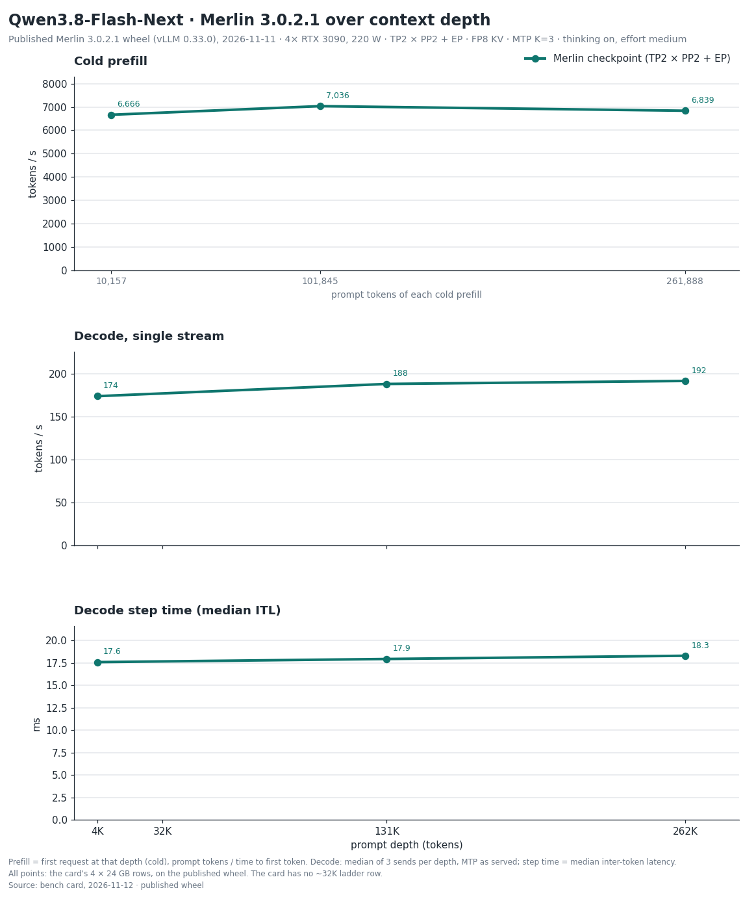

# Qwen3.8-Flash-Next — Merlin 3.0.2.1 bench card, 2026-11-12

> **Provenance.** Maintainer measurements on the reference host: 4 x RTX 3090 at 220 W with P2P enabled (aikitoria's open-gpu-kernel-modules P2P driver) and Zagitta's gpu-unlock, PCIe Gen4, no NVLink, driver 610.43.02. Streams are client-timed; drivers, raw streams and boot logs are not published.
> Engine: Merlin 3.0.2.1 on vLLM 0.33.0. The 4 x 24 GB decode, exact-262K, prefill, thinking-on 8-agent, GSM8K-200 and quality-panel rows were measured on the published 3.0.2.1 wheel `0.33.0+merlin.c56eeed392` on 2026-11-11. The 4 x 20 GB rows and the thinking-off 8-agent row were not re-measured on it and keep their figures from the previous build (the 3.0.2.1 wheel `0.33.0+merlin.c56eeed392` as built on 2026-11-10, before the prefill runs change): the 4 x 20 GB rows (2026-11-10; the new schedule is on by default on those rows too and was not measured there) and the thinking-off 8-agent row (2026-11-11; its run on the published wheel ended early and was not used).
> Served by `merlin serve` with the shipped defaults, on separate fresh boots: 4 x 24 GB decode, prefill and thinking-on agents; 4 x 20 GB; thinking-on GSM8K-200; thinking-off GSM8K-200 and the thinking-off 8-agent row; and the quality panel. Measured 2026-11-10 and 2026-11-11 (UTC). Decode comparisons use medians; cold prefill is one request per depth and each 8-agent figure is one overlap run.
>
> Checkpoint: [halt95/Qwen3.8-Flash-Next-W4A16-Merlin](https://huggingface.co/halt95/Qwen3.8-Flash-Next-W4A16-Merlin). The 3.0.2 column is the [2026-11-04 card](../2026-11-04/BENCH-CARD.md).
> Layout: TP2 × PP2 + EP on four cards (`fn-quad-3090`), MTP K=3 probabilistic, FP8 KV; thinking-on effort `medium` (the server default); boot 306 s (first start of this configuration: graphs compiled, none loaded from cache); KV pool 924,993 tokens. On the previous build, a later start of this four-card layout on the same install, which loaded the cached compiled graphs, was ready in 166 s against 301 s for that install's first start; the saving is the compile cache and graph warm-up, and weight loading was not faster (most weights were read from disk in both starts).
> 20 GB row: `fn-quad-20g-sm86` on 4 x RTX 3090 emulating 20 GB cards (4,096 MiB held back per card), cold experts on layers 11, 12, 19, 20 and 37; boot 185 s (first start of this configuration, compiled graphs not yet cached); a later start that loaded the cached graphs took 171 s; KV pool 265,888 tokens (1.01× at 262K). Not measured on real 20 GB cards, and not re-measured on the published wheel (previous build, 2026-11-10).

## 1. Single-stream decode ladder

Same frozen ladder driver as the 3.0.2 card: T=0, a needle prompt at depth, every send a cold prefill, ≤ 256 tokens
with thinking on and the no-think answer-plus-summary task with thinking off (natural stop, ≤ 1,024 tokens); 3 sends
per cell, each cell the median of the valid sends. tok/s = tokens after the first streamed event / time from the first
to the last event. With MTP, read the median event interval (ITL) together with tokens per event.

| prompt tokens | thinking | 3.0.2.1 tok/s | 3.0.2 tok/s | change | ITL ms | tokens/event | TTFT s | valid |
|---|---|---|---|---|---|---|---|---|
| 4,046 | on | 174.0 | 172.4 | +1 % | 17.59 | 3.02 | 0.67 | 3/3 |
| 130,386 | on | 188.3 | 188.7 | 0 % | 17.94 | 3.28 | 18.64 | 3/3 |
| 4,105 | off | 127.5 | 128.8 | −1 % | 17.71 | 2.25 | 0.68 | 3/3 |
| 130,445 | off | 132.9 | 134.5 | −1 % | 18.12 | 2.39 | 18.55 | 3/3 |

### 4 x 20 GB (emulated)

There is no published 3.0.2 20 GB card, so these rows have no 3.0.2 column; the 20 GB figures are not comparable with the 24 GB table above. The 20 GB rows in sections 1–3 were not re-measured on the published wheel (previous build, 2026-11-10).

| prompt tokens | thinking | 3.0.2.1 tok/s | 3.0.2 tok/s | change | ITL ms | tokens/event | TTFT s | valid |
|---|---|---|---|---|---|---|---|---|
| 4,046 | on | 147.5 | - | - | 19.96 | 3.02 | 1.02 | 3/3 |
| 130,386 | on | 158.4 | - | - | 20.79 | 3.28 | 28.08 | 3/3 |
| 4,105 | off | 119.3 | - | - | 18.79 | 2.25 | 1.06 | 3/3 |
| 130,445 | off | 124.8 | - | - | 19.11 | 2.39 | 28.10 | 3/3 |

## 2. Exact 262K

Exactly 261,888 prompt tokens with a 128-token output cap, both thinking modes, one stream, 3 sends with one cache salt
(send 1 cold); each send uses a different prompt text. Decode, ITL and tokens per event are the median of the 3 sends;
TTFT is send 1's. The sends column gives the range of the three sends.

With speculative decoding (MTP), the number of tokens produced per decode step depends on the text being generated, so
over 128 tokens the rate varies from send to send with the text; the range is given beside each median. Measured on
this release on the 27B two-card layout with thinking off: the same prompt text sent 100 times, across four server
starts, gave identical output every time and 100.0–103.5 tok/s, at 2.783 tokens per step on every send; three other
texts gave 106.9–110.3 tok/s; the time per decode step was flat, 27.5–27.9 ms at the client and 28.3–28.6 ms in the
server. On that row the previous development build and this release gave identical output and the same rate (a
paired difference of +0.3 to +0.5 %, inside the difference of about 1 % between two starts of the same build). This
was measured on that one layout and thinking mode only.

| prompt tokens | thinking | 3.0.2.1 tok/s (median) | 3.0.2.1 sends, tok/s | 3.0.2 tok/s | change | ITL ms | tokens/event | cold TTFT s |
|---|---|---|---|---|---|---|---|---|
| 261,888 | on | 191.8 | 191.4–200.3 | 206.7 | −7 % | 18.30 | 3.28 | 38.3 |
| 261,888 | off | 143.6 | 142.6–147.4 | 152.9 | −6 % | 18.31 | 2.51 | 38.3 |

In this run send 2 was served cold as well. Thinking on: send 3 reused 135,168 tokens; thinking off: send 3 reused 135,168 tokens.

Spread over 6 sends (the three above plus three more on the same boot, each set with its own cold salt): thinking on 191.6 tok/s (172.4–200.3), thinking off 145.4 tok/s (142.6–153.4).

**Flash-Next against 3.0.2.** Each decode step is within 2 % of 3.0.2 (median event interval 18.30 ms against 18.04 ms). The 128-token figure moves with the tokens produced per step (3.28 here, 3.56 on the 3.0.2 card), which depend on the text sent. A repeat run of Flash-Next on 3.0.2 measured 193 tok/s (sends 184–207); the published 206.7 came from different send texts, and the range of sends on this release is given above.

Thinking off at 262K is −6 % against 3.0.2 (sends 142.6–147.4 here, 144.2–157.3 on 3.0.2). Median event interval 18.31 ms against 18.23 ms; tokens per event 2.51 against 2.67. The step time is within 1 %, so the difference follows the tokens produced per step, which depend on the text sent.

### 4 x 20 GB (emulated)

| prompt tokens | thinking | 3.0.2.1 tok/s (median) | 3.0.2.1 sends, tok/s | 3.0.2 tok/s | change | ITL ms | tokens/event | cold TTFT s |
|---|---|---|---|---|---|---|---|---|
| 261,888 | on | 165.1 | 163.5–168.6 | - | - | 20.49 | 3.20 | 57.5 |
| 261,888 | off | 122.5 | 117.8–131.9 | - | - | 19.34 | 2.33 | 57.4 |

On the 20 GB row no send reused the prefix in either thinking mode.

## 3. Cold prefill

| prompt tokens | 3.0.2.1 prefill | 3.0.2 prefill | change | TTFT s |
|---|---|---|---|---|
| 10,157 | 6,666 tok/s | 6,585 tok/s | +1 % | 1.52 |
| 101,845 | 7,036 tok/s | 6,994 tok/s | +1 % | 14.47 |
| 261,888 | 6,839 tok/s | 6,782 tok/s | +1 % | 38.3 |

### 4 x 20 GB (emulated)

| prompt tokens | 3.0.2.1 prefill | 3.0.2 prefill | change | TTFT s |
|---|---|---|---|---|
| 10,157 | 4,434 tok/s | - | - | 2.29 |
| 101,845 | 4,656 tok/s | - | - | 21.87 |
| 261,888 | 4,555 tok/s | - | - | 57.5 |

One cold send per depth (8 tokens out at 10K and 100K). The 262K row is the cold thinking-on send of table 2:
prompt tokens / time to first token.

## 4. Agents at once

Eight 16K conversations, then eight simultaneous 512-token follow-ups, temperature 0. Thinking on is reasoning effort
medium (the server default), each request setting medium. A 512-token follow-up may end inside the reasoning, and
reasoning tokens count, so these totals measure decoded tokens, not finished answers. Total tok/s = tokens decoded
while all eight stream / that overlap window. Each row is one run of 8; a window under 5 s is short, so read that
total loosely, as on the 3.0.2 card.

| layout | thinking | 3.0.2.1 total tok/s | 3.0.2 tok/s | change | overlap window s |
|---|---|---|---|---|---|
| Four cards | on | 640 | 654 | −2 % | 5.83 |
| Four cards | off | 641 (2026-11-11, previous build; the run on the published wheel ended early, one of the eight replies stopping by itself after 33 tokens and an overlap window of 0.25 s, and was not used) | 664 (the 3.0.2 thinking-off figure is the 3.0.1 run the 3.0.2 card carried over) | −3 % | 6.09 |

The thinking-on figure is one run of eight on the card's boot. The same row moves by several percent between identical runs: run six times over two other boots of the published wheel with the shipped defaults it gave 661–697 tok/s (mean 680), and one run on a further boot gave 624. Its change against 3.0.2 is smaller than that spread and is not a gain or a loss.

The 4 x 20 GB row has no 8-agent figure: its 265,888-token pool holds seven of the eight 16K follow-ups (two lost their cached prefix and had to prefill again, TTFT 19.4 and 18.7 s), so the published "all eight streaming" window cannot be measured there.

## 5. GSM8K and the Flash-Next quality panel

GSM8K-200 (the 3.0.1 card's set and method: 200 problems, 5-shot, temperature 0): thinking on at effort medium **197/200**, none cut at the 8,192-token cap; thinking off **198/200**, 2 cut at the 512-token limit (both on the published wheel). The 3.0.2 card carried 197 (thinking on, 3.0.1 run) and 199 (thinking off, 3.0.0 run). The 20 GB row has no GSM8K run.

Quality panel (published wheel; the 3.0.2 card's method: the full GSM8K test set, 1,319 problems, 5-shot, thinking off, temperature 0, 512 tokens; nine 32K prompts with a follow-up question for a needle in the context):

| measurement | 3.0.2.1 | 3.0.2 | 3.0.1 (first run) | 3.0.1 (second run) |
|---|---|---|---|---|
| GSM8K, correct of 1,319 | 1,276 (96.7 %) | 1,281 (97.1 %) | 1,276 (96.7 %) | 1,275 (96.7 %) |
| 32K needle prompts answered, of 9 | 5 | 4 | 6 | 6 |

On the full GSM8K set 12 replies were cut at the 512-token limit. A run on the previous build of the wheel, also 2026-11-11, scored 1,282 (97.2 %, 9 cut); both were measured. 34 misses are common to the two runs, 9 are only in this one and 3 only in the earlier one: the test sends several questions at once, and at temperature 0 the replies vary between runs under concurrency (740 of the 1,319 replies are word-for-word identical across the two runs). This is not a change between the two builds.

Every needle miss is a refusal (the needle is phrased as a secret passphrase, and the model declined to give it); every answer given was correct.

## 6. Coverage of this card

| figure | status on 3.0.2.1 |
|---|---|
| Decode ladder, exact 262K, cold prefill, 4 x 24 GB | Measured 2026-11-11, published wheel `0.33.0+merlin.c56eeed392` |
| Decode ladder, exact 262K, cold prefill, 4 x 20 GB | Not re-measured on the published wheel: measured 2026-11-10 on the previous build, which does not have the new prefill schedule (on by default on these rows too, not measured there) |
| 8 agents, thinking on, 4 x 24 GB | Measured 2026-11-11, published wheel `0.33.0+merlin.c56eeed392` |
| 8 agents, thinking off, 4 x 24 GB | Not re-measured on the published wheel: measured 2026-11-11 on a separate boot, previous build; the run on the published wheel ended early (overlap window 0.25 s) and was not used |
| 8 agents, 4 x 20 GB | Not applicable: the pool holds seven of eight follow-ups |
| GSM8K-200, thinking on, 4 x 24 GB | Measured 2026-11-11, published wheel `0.33.0+merlin.c56eeed392` |
| GSM8K-200, thinking off, 4 x 24 GB | Measured 2026-11-11, published wheel `0.33.0+merlin.c56eeed392` |
| GSM8K-200, 4 x 20 GB | Not run |
| Full GSM8K and the 32K needle panel | Measured 2026-11-11, published wheel `0.33.0+merlin.c56eeed392` |
| 8 MP images, 4 x 20 GB | Not re-measured on the published wheel: measured 2026-11-10 on the previous build of the wheel: lowest free memory over the image rows, counted as total minus used and sampled every 100 ms, 955 MiB on two cards and 903 MiB on the other two; an earlier run on the previous development build read 835 and 863 MiB; 835 to 955 MiB across the two runs, all above the 24 GB rows' 524 MiB margin |
| Sessions held at once | Not re-run; [3.0.0 card](../2026-10-20/BENCH-CARD.md) section 4, 2026-10-20 |
| 8 MP images, 4 x 24 GB | Not re-run; [3.0.0 card](../2026-10-20/BENCH-CARD.md) section 5, 2026-10-20 |
| Needle panel at 131K and 262K | Not re-run; [3.0.0 card](../2026-10-20/BENCH-CARD.md) section 6, pre-release build, 2026-10-17 |

Carried-over figures, dated: sessions held at once (3 × 262K and 6 × 131K) and the 4 x 24 GB 8 MP image panels are from the 3.0.0 run of 2026-10-20.

Other CPU load on the host: none during any row, the 20 GB row included.
