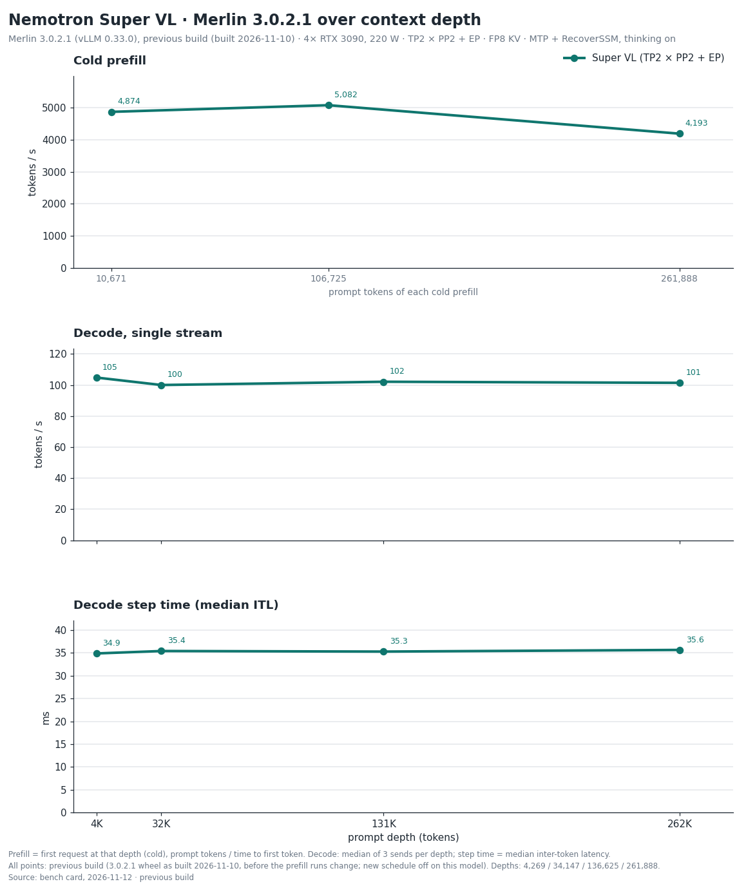

# Nemotron 3.5 Super VL — Merlin 3.0.2.1 bench card, 2026-11-12

> **Provenance.** Maintainer measurements on the reference host: 4 x RTX 3090 at 220 W with P2P enabled (aikitoria's open-gpu-kernel-modules P2P driver) and Zagitta's gpu-unlock, PCIe Gen4, no NVLink, driver 610.43.02. Streams are client-timed; drivers, raw streams and boot logs are not published.
> Engine: Merlin 3.0.2.1 on vLLM 0.33.0. The rows measured 2026-11-10 and 2026-11-11 ran on the previous build (the 3.0.2.1 wheel `0.33.0+merlin.c56eeed392` as built on 2026-11-10, before the prefill runs change). The thinking-off ladder rows, measured 2026-11-09, ran on an earlier build of the same wheel version (2026-11-09), before the engine changes of 2026-11-10. The published wheel differs from the previous build in three engine files that carry the new prefill schedule, which is off on this model. On 2026-11-11 the same prompt at temperature 0, one session, gave the same 256 token ids on the published wheel as on the previous build. Served by `merlin serve` with the shipped defaults, on three separate fresh boots: decode, exact-262K and prefill; thinking-on agents and GSM8K-200; thinking-off agents and GSM8K-200. Measured 2026-11-09 to 2026-11-11 (UTC). Decode comparisons use medians; cold prefill is one request per depth and each 8-agent figure is one overlap run.
>
> Checkpoint: [halt95/Nemotron-3.5-Super-VL-120B-A12B-W4A16-Merlin](https://huggingface.co/halt95/Nemotron-3.5-Super-VL-120B-A12B-W4A16-Merlin). The 3.0.2 column is the [2026-11-04 card](../2026-11-04/BENCH-CARD.md).
> Layout: four cards (`svl-quad-3090`), MTP, FP8 KV, the shipped 1M context; thinking on (this template has no effort levels); boot 377 s (first start of this configuration: graphs compiled, none loaded from cache); KV pool 1,856,367 tokens.

## 1. Single-stream decode ladder

Same frozen ladder driver as the 3.0.2 card: T=0, a needle prompt at depth, every send a cold prefill, ≤ 256 tokens
with thinking on and the no-think answer-plus-summary task with thinking off (natural stop, ≤ 1,024 tokens); 3 sends
per cell, each cell the median of the valid sends. tok/s = tokens after the first streamed event / time from the first
to the last event. With MTP, read the median event interval (ITL) together with tokens per event.

| prompt tokens | thinking | 3.0.2.1 tok/s | 3.0.2 tok/s | change | ITL ms | tokens/event | TTFT s | valid |
|---|---|---|---|---|---|---|---|---|
| 4,269 | on | 104.8 | 101.2 | +4 % | 34.86 | 3.61 | 1.05 | 3/3 |
| 34,147 | on | 100.0 | - | - | 35.39 | 3.51 | 6.30 | 3/3 |
| 136,625 | on | 102.1 | 100.6 | +1 % | 35.27 | 3.51 | 27.88 | 3/3 |
| 262,839 | on | 104.9 | - | - | 35.91 | 3.66 | 63.00 | 3/3 |
| 4,328 | off | 89.3 | 86.6 | +3 % | 35.41 | 3.16 | 1.05 | 3/3 |
| 34,206 | off | 90.3 | - | - | 35.06 | 3.16 | 6.26 | 2/3 |
| 136,684 | off | 78.0 | 77.3 | +1 % | 35.48 | 2.71 | 27.85 | 2/3 |
| 262,898 | off | 82.0 | - | - | 35.26 | 2.83 | 62.57 | 2/3 |

Super VL only, as on the 3.0.2 card: with thinking off, a send counts if it returned HTTP 200, generated at least 200 tokens and had no streaming problems. The answer-format, word-count and natural-stop checks are not applied, because at short context the model writes its deliberation as visible text and runs to the 1,024-token limit (all sends at 4K). Those rows time that text, not a finished answer. The sends under 200 tokens at 32K (one), 131K (one) and 262K (one) are excluded. The thinking-off rows are from the 2026-11-09 run under that rule; the 2026-11-10 thinking-off sends failed the standard checks again and are not used.

The thinking-on cells read 95.4 tok/s at 4K and 108.6 tok/s at 131K on 2026-11-09. The time per event was 34.5–35.8 ms on every 4K and 131K send in both runs, so the differences between the two runs follow tokens per event (MTP acceptance), not step time.

## 2. Exact 262K

Exactly 261,888 prompt tokens with a 128-token output cap, both thinking modes, one stream, 3 sends with one cache salt
(send 1 cold); each send uses a different prompt text. Decode, ITL and tokens per event are the median of the 3 sends;
TTFT is send 1's. The sends column gives the range of the three sends.

With speculative decoding (MTP), the number of tokens produced per decode step depends on the text being generated, so
over 128 tokens the rate varies from send to send with the text; the range is given beside each median. Measured on
this release on the 27B two-card layout with thinking off: the same prompt text sent 100 times, across four server
starts, gave identical output every time and 100.0–103.5 tok/s, at 2.783 tokens per step on every send; three other
texts gave 106.9–110.3 tok/s; the time per decode step was flat, 27.5–27.9 ms at the client and 28.3–28.6 ms in the
server. On that row the previous development build and this release gave identical output and the same rate (a
paired difference of +0.3 to +0.5 %, inside the difference of about 1 % between two starts of the same build). This
was measured on that one layout and thinking mode only.

| prompt tokens | thinking | 3.0.2.1 tok/s (median) | 3.0.2.1 sends, tok/s | 3.0.2 tok/s | change | ITL ms | tokens/event | cold TTFT s |
|---|---|---|---|---|---|---|---|---|
| 261,888 | on | 101.4 | 95.3–106.0 | 105.7 | −4 % | 35.63 | 3.37 | 62.5 |
| 261,888 | off | 94.4 | 94.1–97.8 | 86.3 | +9 % | 35.79 | 3.20 | 62.3 |

In this run send 2 was served cold as well. Thinking on: send 3 reused 122,752 tokens; thinking off: no send reused the prefix.

Thinking off at 262K is +9 % against 3.0.2 (sends 94.1–97.8 here, 85.0–87.1 on 3.0.2). This release's three sends: median event interval 35.79 ms and 3.20 tokens per event (3.0.2: 37.19 ms and 3.05). The rate depends on the text sent.

## 3. Cold prefill

| prompt tokens | 3.0.2.1 prefill | 3.0.2 prefill | change | TTFT s |
|---|---|---|---|---|
| 10,671 | 4,874 tok/s | 4,914 tok/s | −1 % | 2.19 |
| 106,725 | 5,082 tok/s | 5,111 tok/s | −1 % | 21.00 |
| 261,888 | 4,193 tok/s | 4,217 tok/s | −1 % | 62.5 |

One cold send per depth (8 tokens out at 10K and 100K). The 262K row is the cold thinking-on send of table 2:
prompt tokens / time to first token.

## 4. Agents at once

Eight 16K conversations, then eight simultaneous 512-token follow-ups, temperature 0. Thinking on (this template has no effort levels; the driver's `medium` has no effect). A 512-token follow-up may end inside the reasoning, and
reasoning tokens count, so these totals measure decoded tokens, not finished answers. Total tok/s = tokens decoded
while all eight stream / that overlap window. Each row is one run of 8; a window under 5 s is short, so read that
total loosely, as on the 3.0.2 card.

| layout | thinking | 3.0.2.1 total tok/s | 3.0.2 tok/s | change | overlap window s |
|---|---|---|---|---|---|
| Four cards | on | 444 | 432 (the 3.0.2 thinking-on figure is the 3.0.1 run the 3.0.2 card carried over) | +3 % | 8.40 |
| Four cards | off | 417 | 432 (the 3.0.2 thinking-off figure is the 3.0.1 run the 3.0.2 card carried over) | −3 % | 9.17 |

## 5. GSM8K-200

The 3.0.1 card's set and method (200 problems, 5-shot, temperature 0), with thinking on (this template has no effort levels) and thinking off on four cards: **196/200** thinking on (2 cut at the 8,192-token cap and left no prediction); **194/200** thinking off, none cut. The 3.0.2 card carried 197/200 (thinking on, 3.0.1 run) and 195/200 (thinking off, 3.0.0 run).

## 6. Coverage of this card

| figure | status on 3.0.2.1 |
|---|---|
| Decode ladder thinking on, exact 262K, cold prefill | Measured 2026-11-10, previous build (not re-measured on the published wheel) |
| Decode ladder thinking off | Measured 2026-11-09, an earlier build of the same wheel version (2026-11-09), before the engine changes of 2026-11-10 (not re-measured on the published wheel or the previous build) |
| 8 agents, thinking on and off | Measured 2026-11-11, previous build (not re-measured on the published wheel) |
| GSM8K-200, thinking on and off | Measured 2026-11-11, previous build (not re-measured on the published wheel) |
| Sessions held at once | Not re-run; [3.0.0 card](../2026-10-20/BENCH-CARD.md) section 4, 2026-10-20 |
| 8 MP images | Not re-run; [3.0.0 card](../2026-10-20/BENCH-CARD.md) section 5, 2026-10-20 |
| Needle panel | Not re-run; [3.0.0 card](../2026-10-20/BENCH-CARD.md) section 6, pre-release build, 2026-10-17 |

Other CPU load on the host: none during any row.
