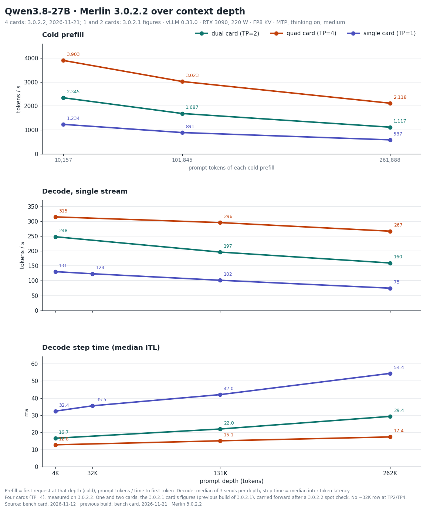

# Qwen3.8-27B — Merlin 3.0.2.2 bench card, 2026-11-21

> **Provenance.** Maintainer measurements on the reference host: 4 x RTX 3090 at 220 W with P2P enabled (aikitoria's open-gpu-kernel-modules P2P driver) and Zagitta's gpu-unlock, PCIe Gen4, no NVLink, driver 610.43.02. Streams are client-timed; drivers, raw streams and boot logs are not published.
> Engine: Merlin 3.0.2.2 on vLLM 0.33.0, measured on 2026-11-21 (UTC) on a tree that carries this release's engine code; the only later non-comment engine change is the MTP layer-index guard on pipeline-parallel layouts, which affects only Ornith 1.5 (re-measured on it).
> What this card covers: the four-card layout, whose decode changed in 3.0.2.2 (the four-card P2P decode settings are now on by default; see the [changelog](../../../../docs/CHANGELOG.md#merlin-3022)). Its spot check read 313.4 tok/s at 4K thinking on against 262.0 tok/s on the 3.0.2.1 card, outside that row's band of ±3 %, so the decode ladder, the exact 262K row and the agents row were run again. The one- and two-card layouts were inside their bands and keep their [3.0.2.1 card](../2026-11-12/BENCH-CARD.md) figures (section 6).
>
> Checkpoint: [halt95/Qwen3.8-27B-W4A16-Merlin](https://huggingface.co/halt95/Qwen3.8-27B-W4A16-Merlin). The 3.0.2.1 column is the [2026-11-12 card](../2026-11-12/BENCH-CARD.md).
> Four cards: TP4, `27b-tp4-3090` as shipped; thinking-on effort `medium` (the server default); boot 201 s; KV pool 2,012,105 tokens.
> MTP K=4, FP8 KV, RecoverSSM on.

## 1. Single-stream decode ladder

Same frozen ladder driver as the 3.0.2.1 card: T=0, a needle prompt at depth, every send a cold prefill, ≤ 256 tokens
with thinking on and the no-think answer-plus-summary task with thinking off (natural stop, ≤ 1,024 tokens); 3 sends
per cell, each cell the median of the valid sends. tok/s = tokens after the first streamed event / time from the first
to the last event. With MTP, read the median event interval (ITL) together with tokens per event.

### Four cards (TP4)

| prompt tokens | thinking | 3.0.2.2 tok/s | 3.0.2.1 tok/s | change | ITL ms | tokens/event | TTFT s | valid |
|---|---|---|---|---|---|---|---|---|
| 4,046 | on | 315.5 | 262.0 | +20 % | 12.82 | 4.00 | 1.06 | 3/3 |
| 130,386 | on | 296.3 | 258.0 | +15 % | 15.14 | 4.41 | 46.19 | 3/3 |
| 4,105 | off | 219.2 | 184.5 | +19 % | 12.86 | 2.84 | 1.13 | 3/3 |
| 130,445 | off | 193.7 | 169.8 | +14 % | 15.37 | 2.95 | 46.37 | 3/3 |

The gain is the time per decode step: the median event interval is 12.82 ms against 15.39 ms at 4K thinking on and
15.14 against 17.48 ms at 131K, while the tokens per event are level (4.00 against 4.00 at 4K).

## 2. Exact 262K

Exactly 261,888 prompt tokens with a 128-token output cap, both thinking modes, one stream, 3 sends with one cache salt
(send 1 cold); each send uses a different prompt text. Decode, ITL and tokens per event are the median of the 3 sends;
TTFT is send 1's. The sends column gives the range of the three sends.

With speculative decoding (MTP), the number of tokens produced per decode step depends on the text being generated, so
over 128 tokens the rate varies from send to send with the text; the range is given beside each median.

### Four cards (TP4)

| prompt tokens | thinking | 3.0.2.2 tok/s (median) | 3.0.2.2 sends, tok/s | 3.0.2.1 tok/s | change | ITL ms | tokens/event | cold TTFT s |
|---|---|---|---|---|---|---|---|---|
| 261,888 | on | 267.2 | 266.7–277.6 | 232.7 | +15 % | 17.41 | 4.27 | 123.6 |
| 261,888 | off | 189.8 | 182.0–205.7 | 163.3 | +16 % | 17.43 | 3.12 | 123.5 |

Thinking on and off: send 3 reused 142,320 tokens.

Spread over 6 sends (the three above plus three more on the same boot, each set with its own cold salt): thinking on
275.4 tok/s (266.7–299.7; 3.0.2.1: 238.1, 230.7–252.6), thinking off 181.1 tok/s (173.0–205.7; 3.0.2.1: 164.6,
163.0–171.5). The median event interval at 262K is 17.41 ms against 19.41 ms on the 3.0.2.1 card.

## 3. Cold prefill

### Four cards (TP4)

| prompt tokens | 3.0.2.2 prefill | 3.0.2.1 prefill | change | TTFT s |
|---|---|---|---|---|
| 10,157 | 3,903 tok/s | 3,901 tok/s | 0 % | 2.60 |
| 101,845 | 3,023 tok/s | 3,017 tok/s | 0 % | 33.69 |
| 261,888 | 2,118 tok/s | 2,115 tok/s | 0 % | 123.6 |

One cold send per depth (8 tokens out at 10K and 100K). The 262K row is the cold thinking-on send of table 2:
prompt tokens / time to first token.

## 4. Agents at once

Eight 16K conversations, then eight simultaneous 512-token follow-ups, temperature 0. Thinking on is reasoning effort
medium (the server default), each request setting medium. A 512-token follow-up may end inside the reasoning, and
reasoning tokens count, so these totals measure decoded tokens, not finished answers. Total tok/s = tokens decoded
while all eight stream / that overlap window. Each row is one run of 8; a window under 5 s is short, so read that
total loosely, as on the 3.0.2.1 card.

| layout | thinking | 3.0.2.2 total tok/s | 3.0.2.1 tok/s | change | overlap window s |
|---|---|---|---|---|---|
| Four cards | on | 1,012 | 970 | +4 % | 3.41 (short) |
| Four cards | off | 857 | 857 | 0 % | 4.36 (short) |

The 3.0.2.1 figures in this table are from that release's previous build (the 3.0.2.1 wheel as built on 2026-11-10 and
2026-11-11), as the coverage table of the [3.0.2.1 card](../2026-11-12/BENCH-CARD.md) records.

## 5. GSM8K-200

The 3.0.1 card's set and method (200 problems, 5-shot, temperature 0). Thinking on at effort medium, on four cards:
**198/200** on the 3.0.2.1 card, not re-run on 3.0.2.2. Thinking off on four cards: **195/200**, 4 cut at the token limit (3.0.2.1: 195/200). Two and one card: the 3.0.2.1 card's
194/200 and 194/200.

## 6. Coverage of this card

| figure | status on 3.0.2.2 |
|---|---|
| Decode ladder, exact 262K, cold prefill, 4 cards | Measured 2026-11-21 |
| 8 agents, thinking on, 4 cards | Measured 2026-11-21 |
| 8 agents and GSM8K-200, thinking off, 4 cards | Measured 2026-11-21 |
| GSM8K-200, thinking on, 4 cards | Carried from the [3.0.2.1 card](../2026-11-12/BENCH-CARD.md) section 5 |
| Two cards (TP2): every section | Carried from the [3.0.2.1 card](../2026-11-12/BENCH-CARD.md). Spot check on 3.0.2.2: 4K thinking-on decode 248.7 tok/s against 248.4 (band ±3 %), 100K prefill 1,670 against 1,687 tok/s (±3 %), KV pool 826,689 tokens as on 3.0.2.1, needle panel 6/6 |
| One card (TP1): every section | Carried from the [3.0.2.1 card](../2026-11-12/BENCH-CARD.md). Spot check on 3.0.2.2: 4K thinking-on decode 130.6 tok/s against 130.7 (±3 %), 100K prefill 893 against 891 tok/s (±3 %), KV pool 271,506 tokens as on 3.0.2.1, needle panel 6/6 |
| KV pool and needle panel, 4 cards | Spot-checked 2026-11-21: pool 2,012,105 tokens as on 3.0.2.1; needle panel 6/6 |
| Sessions held at once, 8 MP images | Not re-run; see the [3.0.2.1 card](../2026-11-12/BENCH-CARD.md) section 6 |

Other CPU load on the host: not recorded on these rows.
