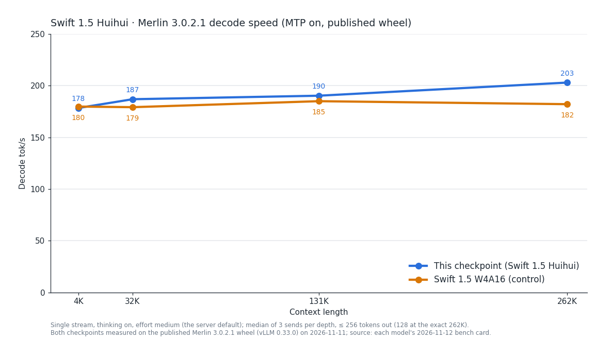

# Swift1.5-Huihui — Merlin 3.0.2.1 bench card, 2026-11-12

> **Provenance.** Maintainer measurements on the reference host: 4 x RTX 3090 at 220 W with P2P enabled (aikitoria's open-gpu-kernel-modules P2P driver) and Zagitta's gpu-unlock, PCIe Gen4, no NVLink, driver 610.43.02. Streams are client-timed; drivers, raw streams and boot logs are not published.
> Engine: Merlin 3.0.2.1 on vLLM 0.33.0. Every 3.0.2.1 row on this card (sections 1–5) except the thinking-off 8-agent row was measured on the published 3.0.2.1 wheel `0.33.0+merlin.c56eeed392` on 2026-11-11. That row's run on the published wheel ended early and was not used; it keeps its figure, measured 2026-11-11, from the previous build (the 3.0.2.1 wheel `0.33.0+merlin.c56eeed392` as built on 2026-11-10, before the prefill runs change). Served by `merlin serve` with the shipped defaults, on three separate fresh boots: decode, exact-262K and prefill; thinking-on agents and GSM8K-200; thinking-off agents and GSM8K-200. Measured 2026-11-11 (UTC). Decode comparisons use medians; cold prefill is one request per depth and each 8-agent figure is one overlap run.
>
> Checkpoint: [halt95/Swift1.5-Huihui-Qwen3.8-Flash-Next-W4A16-Merlin](https://huggingface.co/halt95/Swift1.5-Huihui-Qwen3.8-Flash-Next-W4A16-Merlin). The 3.0.2 column is the [2026-11-05 card](../2026-11-05/BENCH-CARD.md).
> Layout: TP2 × PP2 + EP on four cards (`fn-swift1.5-huihui-quad-3090`), MTP K=3 probabilistic, FP8 KV; thinking-on effort `medium` (the server default); boot 412 s (first start of this configuration: graphs compiled, none loaded from cache); KV pool 924,993 tokens.

## 1. Single-stream decode ladder

Same frozen ladder driver as the 3.0.2 card: T=0, a needle prompt at depth, every send a cold prefill, ≤ 256 tokens
with thinking on and the no-think answer-plus-summary task with thinking off (natural stop, ≤ 1,024 tokens); 3 sends
per cell, each cell the median of the valid sends. tok/s = tokens after the first streamed event / time from the first
to the last event. With MTP, read the median event interval (ITL) together with tokens per event.

| prompt tokens | thinking | 3.0.2.1 tok/s | 3.0.2 tok/s | change | ITL ms | tokens/event | TTFT s | valid |
|---|---|---|---|---|---|---|---|---|
| 4,046 | on | 178.4 | 179.9 | −1 % | 17.80 | 3.14 | 0.66 | 3/3 |
| 32,566 | on | 186.9 | 189.4 | −1 % | 17.87 | 3.28 | 4.59 | 3/3 |
| 130,386 | on | 190.3 | 188.9 | +1 % | 18.02 | 3.32 | 18.51 | 3/3 |
| 259,557 | on | 183.5 | 183.8 | 0 % | 18.31 | 3.24 | 37.80 | 3/3 |
| 4,105 | off | 134.2 | 135.2 | −1 % | 17.66 | 2.36 | 0.68 | 3/3 |
| 32,625 | off | 129.5 | 131.0 | −1 % | 17.80 | 2.30 | 4.59 | 3/3 |
| 130,445 | off | 137.6 | 136.9 | +1 % | 18.10 | 2.46 | 18.57 | 3/3 |
| 259,616 | off | 130.5 | 128.8 | +1 % | 18.14 | 2.36 | 37.81 | 3/3 |

## 2. Exact 262K

Exactly 261,888 prompt tokens with a 128-token output cap, both thinking modes, one stream, 3 sends with one cache salt
(send 1 cold); each send uses a different prompt text. Decode, ITL and tokens per event are the median of the 3 sends;
TTFT is send 1's. The sends column gives the range of the three sends.

With speculative decoding (MTP), the number of tokens produced per decode step depends on the text being generated, so
over 128 tokens the rate varies from send to send with the text; the range is given beside each median. Measured on
this release on the 27B two-card layout with thinking off: the same prompt text sent 100 times, across four server
starts, gave identical output every time and 100.0–103.5 tok/s, at 2.783 tokens per step on every send; three other
texts gave 106.9–110.3 tok/s; the time per decode step was flat, 27.5–27.9 ms at the client and 28.3–28.6 ms in the
server. On that row the previous development build and this release gave identical output and the same rate (a
paired difference of +0.3 to +0.5 %, inside the difference of about 1 % between two starts of the same build). This
was measured on that one layout and thinking mode only.

| prompt tokens | thinking | 3.0.2.1 tok/s (median) | 3.0.2.1 sends, tok/s | 3.0.2 tok/s | change | ITL ms | tokens/event | cold TTFT s |
|---|---|---|---|---|---|---|---|---|
| 261,888 | on | 203.0 | 197.9–209.3 | 192.6 | +5 % | 18.22 | 3.46 | 38.0 |
| 261,888 | off | 138.3 | 132.4–163.6 | 145.8 | −5 % | 18.31 | 2.42 | 38.2 |

In this run send 2 was served cold as well. Thinking on: send 3 reused 139,200 tokens; thinking off: send 3 reused 139,200 tokens.

Thinking on at 262K is +5 % against 3.0.2 (sends 197.9–209.3 here, 191.8–197.0 on 3.0.2). Median event interval 18.22 ms against 18.19 ms; tokens per event 3.46 against 3.28. The step time is within 1 %, so the difference follows the tokens produced per step, which depend on the text sent.

Thinking off at 262K is −5 % against 3.0.2 (sends 132.4–163.6 here, 144.0–163.6 on 3.0.2). Median event interval 18.31 ms against 18.34 ms; tokens per event 2.42 against 2.56. The step time is within 1 %, so the difference follows the tokens produced per step, which depend on the text sent.

## 3. Cold prefill

| prompt tokens | 3.0.2.1 prefill | 3.0.2 prefill | change | TTFT s |
|---|---|---|---|---|
| 10,157 | 6,720 tok/s | 6,608 tok/s | +2 % | 1.51 |
| 101,845 | 7,076 tok/s | 7,008 tok/s | +1 % | 14.39 |
| 261,888 | 6,893 tok/s | 6,830 tok/s | +1 % | 38.0 |

One cold send per depth (8 tokens out at 10K and 100K). The 262K row is the cold thinking-on send of table 2:
prompt tokens / time to first token.

## 4. Agents at once

Eight 16K conversations, then eight simultaneous 512-token follow-ups, temperature 0. Thinking on is reasoning effort
medium (the server default), each request setting medium. A 512-token follow-up may end inside the reasoning, and
reasoning tokens count, so these totals measure decoded tokens, not finished answers. Total tok/s = tokens decoded
while all eight stream / that overlap window. Each row is one run of 8; a window under 5 s is short, so read that
total loosely, as on the 3.0.2 card.

| layout | thinking | 3.0.2.1 total tok/s | 3.0.2 tok/s | change | overlap window s |
|---|---|---|---|---|---|
| Four cards | on | 719 | 718 | 0 % | 5.19 |
| Four cards | off | 668 (2026-11-11, previous build; the run on the published wheel ended early, a reply stopping by itself and an overlap window of 0.29 s, and was not used) | 681 (the 3.0.2 thinking-off figure is the 3.0.1 run the 3.0.2 card carried over) | −2 % | 5.83 |

Each row is one run of eight. The same thinking-on row on Flash-Next spread 5 % across six repeated runs (661–697 tok/s), so the change column here is not a gain or a loss against 3.0.2.

## 5. GSM8K-200

The 3.0.1 card's set and method (200 problems, 5-shot, temperature 0), with thinking on at effort medium on four cards and thinking off: **198/200** thinking on, none cut at the 8,192-token cap; **197/200** thinking off, 2 cut at the 512-token limit. The 3.0.2 card scored 198/200 with thinking on; the thinking-off score carried on the 3.0.2 card is 198/200 (3.0.0 run).

## 6. Coverage of this card

| figure | status on 3.0.2.1 |
|---|---|
| Decode ladder, exact 262K, cold prefill | Measured 2026-11-11, published wheel `0.33.0+merlin.c56eeed392` |
| 8 agents, thinking on | Measured 2026-11-11, published wheel `0.33.0+merlin.c56eeed392` |
| 8 agents, thinking off | Not re-measured on the published wheel: measured 2026-11-11, previous build; the run on the published wheel ended early (overlap window 0.29 s) and was not used |
| GSM8K-200, thinking on | Measured 2026-11-11, published wheel `0.33.0+merlin.c56eeed392` |
| GSM8K-200, thinking off | Measured 2026-11-11, published wheel `0.33.0+merlin.c56eeed392` |
| Sessions held at once | Not re-run; [3.0.0 card](../2026-10-20/BENCH-CARD.md) section 4, 2026-10-20 |
| 8 MP images | Not re-run; [3.0.0 card](../2026-10-20/BENCH-CARD.md) section 5, 2026-10-20 |
| Needle panel | Not re-run; [3.0.0 card](../2026-10-20/BENCH-CARD.md) section 6, pre-release build, 2026-10-17 |

Other CPU load on the host: none during any row.
