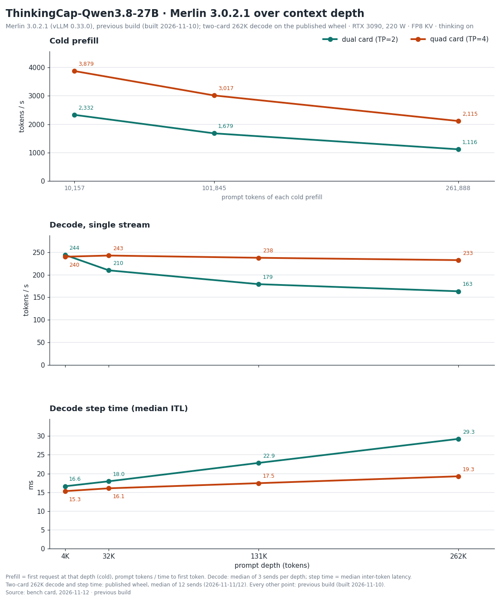

# ThinkingCap — Merlin 3.0.2.1 bench card, 2026-11-12

> **Provenance.** Maintainer measurements on the reference host: 4 x RTX 3090 at 220 W with P2P enabled (aikitoria's open-gpu-kernel-modules P2P driver) and Zagitta's gpu-unlock, PCIe Gen4, no NVLink, driver 610.43.02. Streams are client-timed; drivers, raw streams and boot logs are not published.
> Engine: Merlin 3.0.2.1 on vLLM 0.33.0. Every 3.0.2.1 row on this card except the two-card exact-262K rows ran on the previous build (the 3.0.2.1 wheel `0.33.0+merlin.c56eeed392` as built on 2026-11-10, before the prefill runs change); the published wheel differs from it in three engine files that carry the new prefill schedule, which is off on this model. On 2026-11-11 the same prompt at temperature 0, one session, gave the same 256 token ids on the published wheel as on the previous build. The two-card exact-262K rows were re-measured on the published wheel `0.33.0+merlin.c56eeed392`, 12 sends per mode (thinking on 2026-11-12, thinking off 2026-11-11 to 2026-11-12 UTC; section 2). Served by `merlin serve` with the shipped defaults, on separate fresh boots per layout: decode, exact-262K and prefill; thinking-on agents (with GSM8K-200 on four cards); thinking-off agents and GSM8K-200. Measured 2026-11-10 to 2026-11-12 (UTC). Decode comparisons use medians; cold prefill is one request per depth and each 8-agent figure is one overlap run.
>
> Checkpoint: [halt95/ThinkingCap-Qwen3.8-27B-W4A16-Merlin](https://huggingface.co/halt95/ThinkingCap-Qwen3.8-27B-W4A16-Merlin). The 3.0.2 column is the [2026-11-05 card](../2026-11-05/BENCH-CARD.md).
> Four cards: TP4, `27b-tp4-3090`; thinking-on effort `medium` (the server default); boot 176 s (first start of this configuration: graphs compiled, none loaded from cache); KV pool 2,012,105 tokens.
> Two cards: TP2 on GPUs 0 and 2, `27b-tp2-3090` with P2P on (the six launcher defaults of 3.0.2.1); boot 161 s (first start of this configuration); KV pool 826,689 tokens.
> MTP K=4, FP8 KV, RecoverSSM on.

## 1. Single-stream decode ladder

Same frozen ladder driver as the 3.0.2 card: T=0, a needle prompt at depth, every send a cold prefill, ≤ 256 tokens
with thinking on and the no-think answer-plus-summary task with thinking off (natural stop, ≤ 1,024 tokens); 3 sends
per cell, each cell the median of the valid sends. tok/s = tokens after the first streamed event / time from the first
to the last event. With MTP, read the median event interval (ITL) together with tokens per event.

### Four cards (TP4)

| prompt tokens | thinking | 3.0.2.1 tok/s | 3.0.2 tok/s | change | ITL ms | tokens/event | TTFT s | valid |
|---|---|---|---|---|---|---|---|---|
| 4,046 | on | 240.1 | 237.8 | +1 % | 15.34 | 3.65 | 1.06 | 3/3 |
| 32,566 | on | 242.7 | 240.1 | +1 % | 16.09 | 3.78 | 8.77 | 3/3 |
| 130,386 | on | 237.7 | 234.5 | +1 % | 17.46 | 3.86 | 46.45 | 3/3 |
| 259,557 | on | 245.2 | 240.8 | +2 % | 19.31 | 4.42 | 122.03 | 3/3 |
| 4,105 | off | 186.0 | 184.2 | +1 % | 15.38 | 2.85 | 1.13 | 3/3 |
| 32,625 | off | 175.3 | 175.5 | 0 % | 16.13 | 2.82 | 8.81 | 3/3 |
| 130,445 | off | 161.0 | 158.1 | +2 % | 17.46 | 2.76 | 46.50 | 3/3 |
| 259,616 | off | 143.9 | 142.9 | +1 % | 19.27 | 2.74 | 121.98 | 3/3 |

### Two cards (TP2, GPUs 0 and 2)

| prompt tokens | thinking | 3.0.2.1 tok/s | 3.0.2 tok/s | change | ITL ms | tokens/event | TTFT s | valid |
|---|---|---|---|---|---|---|---|---|
| 4,046 | on | 244.0 | 204.8 | +19 % | 16.64 | 3.98 | 1.74 | 3/3 |
| 32,566 | on | 209.8 | 182.7 | +15 % | 17.96 | 3.72 | 15.09 | 3/3 |
| 130,386 | on | 179.1 | 168.8 | +6 % | 22.86 | 3.86 | 84.61 | 3/3 |
| 259,557 | on | 160.1 | 158.1 | +1 % | 28.58 | 4.38 | 231.65 | 3/3 |
| 4,105 | off | 175.5 | 149.8 | +17 % | 16.72 | 2.95 | 1.76 | 3/3 |
| 32,625 | off | 160.8 | 140.6 | +14 % | 18.06 | 2.91 | 15.03 | 3/3 |
| 130,445 | off | 122.1 | 115.8 | +5 % | 22.68 | 2.74 | 84.88 | 3/3 |
| 259,616 | off | 98.8 | 97.9 | +1 % | 28.56 | 2.80 | 232.11 | 3/3 |

## 2. Exact 262K

Exactly 261,888 prompt tokens with a 128-token output cap, both thinking modes, one stream, 3 sends with one cache salt
(send 1 cold); each send uses a different prompt text. Decode, ITL and tokens per event are the median of the 3 sends;
TTFT is send 1's. The sends column gives the range of the three sends.

With speculative decoding (MTP), the number of tokens produced per decode step depends on the text being generated, so
over 128 tokens the rate varies from send to send with the text; the range is given beside each median. Measured on
this release on the 27B two-card layout with thinking off: the same prompt text sent 100 times, across four server
starts, gave identical output every time and 100.0–103.5 tok/s, at 2.783 tokens per step on every send; three other
texts gave 106.9–110.3 tok/s; the time per decode step was flat, 27.5–27.9 ms at the client and 28.3–28.6 ms in the
server. On that row the previous development build and this release gave identical output and the same rate (a
paired difference of +0.3 to +0.5 %, inside the difference of about 1 % between two starts of the same build). This
was measured on that one layout and thinking mode only.

### Four cards (TP4)

| prompt tokens | thinking | 3.0.2.1 tok/s (median) | 3.0.2.1 sends, tok/s | 3.0.2 tok/s | change | ITL ms | tokens/event | cold TTFT s |
|---|---|---|---|---|---|---|---|---|
| 261,888 | on | 232.5 | 220.9–244.3 | 223.0 | +4 % | 19.29 | 4.13 | 123.8 |
| 261,888 | off | 151.3 | 145.0–151.8 | 153.3 | −1 % | 19.40 | 2.84 | 123.7 |

### Two cards (TP2, GPUs 0 and 2)

| prompt tokens | thinking | 3.0.2.1 tok/s (median) | 3.0.2.1 sends, tok/s | 3.0.2 tok/s | change | ITL ms | tokens/event | cold TTFT s |
|---|---|---|---|---|---|---|---|---|
| 261,888 | on | 163.3 | 144.9–165.2 | 160.4 | level: step time 29.26 ms against 29.34 ms | 29.26 | 4.36 | 233.8 |
| 261,888 | off | 101.2 | 97.6–106.9 | 100.4 | level: step time 28.72 ms against 28.73 ms | 28.72 | 2.75 | 234.3 |

In this run send 2 was served cold as well. Four cards, thinking on: send 3 reused 142,320 tokens; thinking off: send 3 reused 142,320 tokens. Two cards, thinking on: send 3 reused 142,064 tokens; thinking off: send 3 reused 142,064 tokens.

On four cards every exact-262K send ran to the 128-token cap.

Two cards: these rows were re-measured on the published wheel with 12 sends per mode, four sets of the three-send protocol above: 12 prompts that differ only in a nonce near the end; in each set sends 1 and 2 were cold and send 3 reused 142,064 tokens. Medians and ranges are over the 12 sends; cold TTFT is the median of the eight cold sends (thinking on 233.6–234.0 s, thinking off 234.1–234.7 s). Every thinking-off send ran to the cap.

Over 128 output tokens this row's rate is set by how many tokens each step accepts, which depends on the text generated. With thinking on, the same prompt with a different nonce either finishes thinking and answers within the 128 tokens (seven of the 12 sends, stopping at 122 tokens: 4.36 tokens per step, 163.2–165.2 tok/s) or spends all 128 tokens thinking (five sends: 3.88–4.13 tokens per step, 144.9–153.0 tok/s); which one a send lands in does not follow cold against cached. The step time is the same in both, 29.1–29.5 ms. The three-send medians on the 3.0.2 card (160.4; sends 151.6–160.8) and in the first 3.0.2.1 run of this row (2026-11-10, previous build: 147.8; sends 143.2, 147.8 and 163.7, of which only the last answered within the cap) sampled these two outcomes in different proportions; that run's step time was 29.34–29.40 ms per send, and the 3.0.2 card's median is 29.34 ms. Against 3.0.2 the step time is level in both modes, so the row is not a gain or a loss.

## 3. Cold prefill

### Four cards (TP4)

| prompt tokens | 3.0.2.1 prefill | 3.0.2 prefill | change | TTFT s |
|---|---|---|---|---|
| 10,157 | 3,879 tok/s | 3,885 tok/s | 0 % | 2.62 |
| 101,845 | 3,017 tok/s | 3,010 tok/s | 0 % | 33.76 |
| 261,888 | 2,115 tok/s | 2,108 tok/s | 0 % | 123.8 |

### Two cards (TP2, GPUs 0 and 2)

| prompt tokens | 3.0.2.1 prefill | 3.0.2 prefill | change | TTFT s |
|---|---|---|---|---|
| 10,157 | 2,332 tok/s | 2,322 tok/s | 0 % | 4.35 |
| 101,845 | 1,679 tok/s | 1,679 tok/s | 0 % | 60.66 |
| 261,888 | 1,116 tok/s | 1,115 tok/s | 0 % | 234.6 |

One cold send per depth (8 tokens out at 10K and 100K). The 262K row is the cold thinking-on send of table 2:
prompt tokens / time to first token. On two cards that is the 2026-11-10 send on the previous build; the cold sends of the
12-send rerun on the published wheel took 233.6–234.0 s.

## 4. Agents at once

Eight 16K conversations, then eight simultaneous 512-token follow-ups, temperature 0. Thinking on is reasoning effort
medium (the server default), each request setting medium. A 512-token follow-up may end inside the reasoning, and
reasoning tokens count, so these totals measure decoded tokens, not finished answers. Total tok/s = tokens decoded
while all eight stream / that overlap window. Each row is one run of 8; a window under 5 s is short, so read that
total loosely, as on the 3.0.2 card.

| layout | thinking | 3.0.2.1 total tok/s | 3.0.2 tok/s | change | overlap window s |
|---|---|---|---|---|---|
| Four cards | on | 974 | 939 | +4 % | 3.55 (short) |
| Four cards | off | 856 | 832 (the 3.0.2 thinking-off figure is the 3.0.1 run the 3.0.2 card carried over) | +3 % | 4.31 (short) |
| Two cards | on | 731 | 708 | +3 % | 4.83 (short) |
| Two cards | off | 663 | 633 (the 3.0.2 thinking-off figure is the 3.0.1 run the 3.0.2 card carried over) | +5 % | 5.68 |

## 5. GSM8K-200

The 3.0.1 card's set and method (200 problems, 5-shot, temperature 0), with thinking on at effort medium on four cards and thinking off: **196/200** thinking on, none cut at the 8,192-token cap; **193/200** thinking off on four cards (4 cut at the 512-token limit) and **195/200** on two cards (3 cut). GSM8K with thinking on runs on the four-card boot, so the two-card layout has no thinking-on row. The 3.0.2 card scored 198/200 with thinking on; the thinking-off scores carried on the 3.0.2 card are 195/200 (four cards) and 193/200 (two cards), both from the 3.0.0 run.

## 6. Coverage of this card

| figure | status on 3.0.2.1 |
|---|---|
| Decode ladder and cold prefill, 4 and 2 cards; exact 262K, 4 cards | Measured 2026-11-10, previous build (not re-measured on the published wheel) |
| Exact 262K, 2 cards | Measured 2026-11-12 (thinking on) and 2026-11-11 to 2026-11-12 (thinking off), published wheel `0.33.0+merlin.c56eeed392`, 12 sends per mode |
| 8 agents, thinking on and off, 4 and 2 cards | Measured 2026-11-11, previous build (not re-measured on the published wheel) |
| GSM8K-200, thinking on (4 cards) and off (4, 2 cards) | Measured 2026-11-11, previous build (not re-measured on the published wheel) |
| Sessions held at once | Not re-run; [3.0.0 card](../2026-10-20/BENCH-CARD.md) section 4, 2026-10-20 |
| 8 MP images | Not re-run; [3.0.0 card](../2026-10-20/BENCH-CARD.md) section 5, 2026-10-20. Measured on 3.0.2.1, previous build (not re-measured on the published wheel): the memory floor during the 8 MP rows with the new capture sizes on four cards: 796 MiB on every card (total minus used), sampled every 100 ms on a fresh boot with no decode before the images (the 27B checkpoint and ThinkingCap, one run each); with decode run first, the readings at one-second sampling were 798 and 796 MiB; 764 MiB on two cards (total minus used) |
| Needle panel | Not re-run; [3.0.0 card](../2026-10-20/BENCH-CARD.md) section 6, pre-release build, 2026-10-17 |

Other CPU load on the host: none during any row, except the two-card exact-262K rows, which ran with other CPU load on the host during most of their sends; their step time (29.1–29.5 ms thinking on, 28.2–29.0 ms thinking off) matches the earlier runs.
